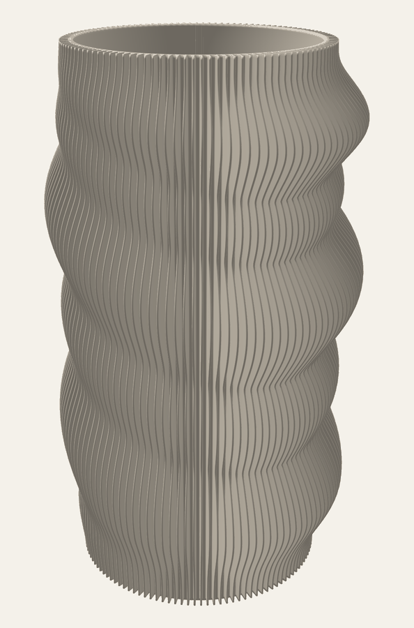
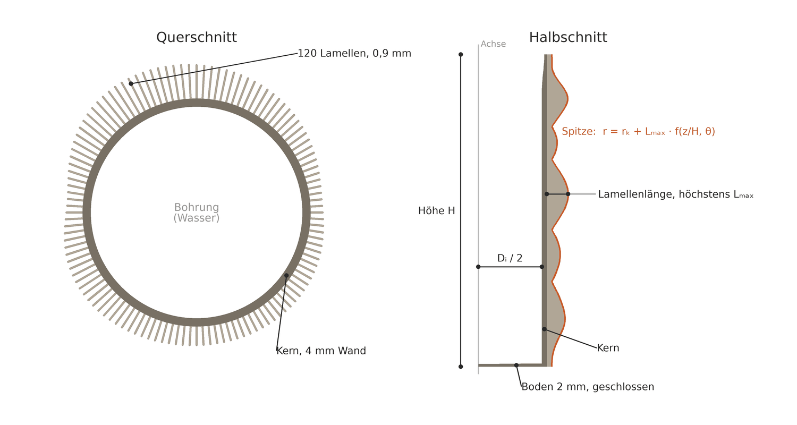
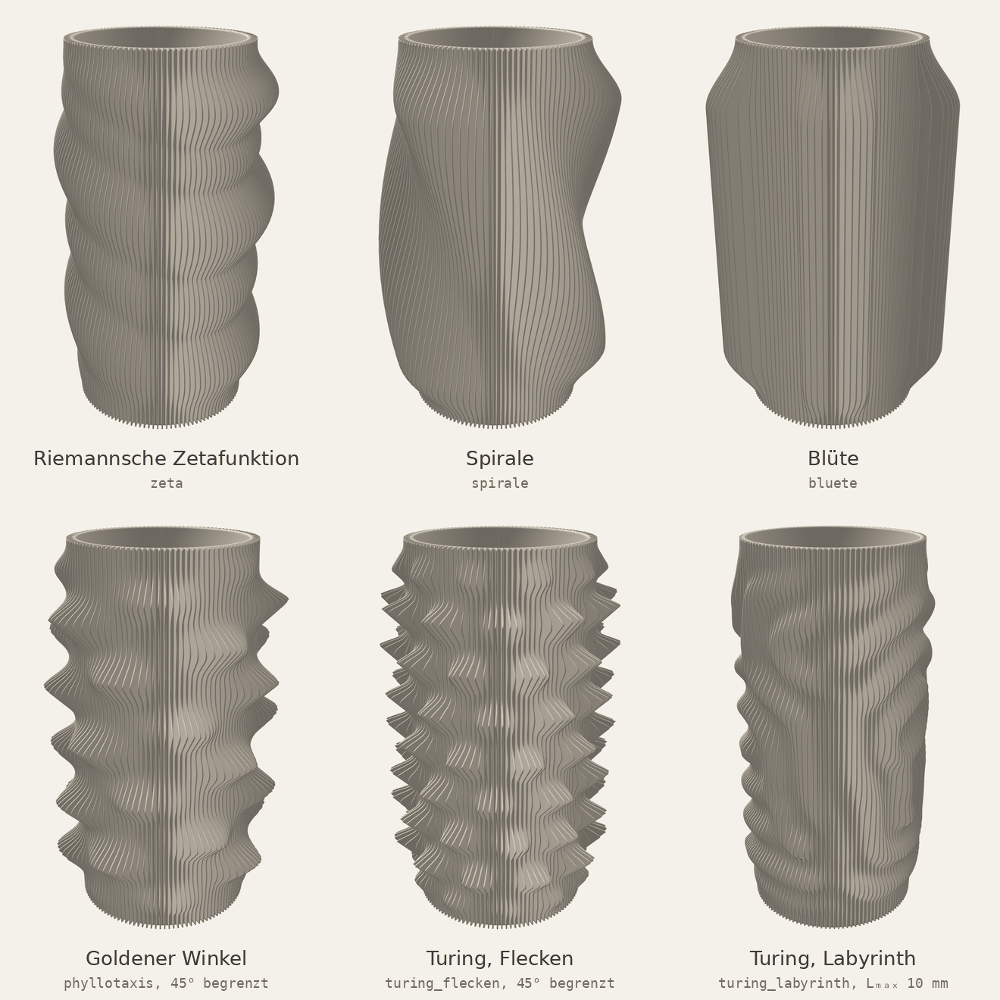
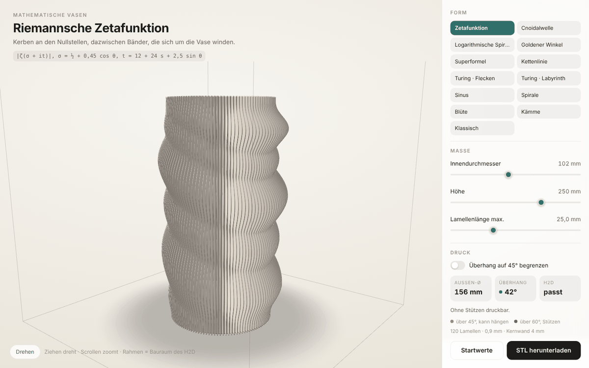

# Mathematische Vasen

Parametrischer Generator für 3D-gedruckte Vasen. Die Außenform wird durch eine Funktion $`f(s, \theta)`$ über Höhe und Umfangswinkel beschrieben. Sie legt die Länge von 120 radialen Lamellen fest, die auf einem zylindrischen Kern stehen. Implementiert sind 13 Funktionen, unter anderem die Riemannsche Zetafunktion, eine Anordnung nach dem goldenen Winkel und Reaktions-Diffusions-Muster nach Gray und Scott.

Der Generator (`tools/vase_generator.py`) schreibt aus einer Konfigurationsdatei ein geschlossenes STL-Netz für den Slicer. Eine 3D-Ansicht im Browser rechnet dieselben Funktionen und erlaubt, Maße und Form interaktiv zu ändern.

<p align="center"></p>

**Inhalt:** [Die Grundform](#die-grundform) · [Die Formen](#die-formen) · [Schnellstart](#schnellstart) · [3D-Ansicht](#3d-ansicht) · [Druck und Überhang](#druck-und-überhang) · [Konfiguration](#konfiguration) · [Mathematik](#mathematik) · [Ordner](#ordner)

## Die Grundform

Alle Vasen haben denselben Aufbau aus drei Teilen:

- **Kern:** zylindrisches Rohr mit 4 mm Wand und geschlossenem, 2 mm dickem Boden. Der Kern ist das wasserführende Bauteil. Innendurchmesser 102 mm, zur Mündung hin auf 106 mm erweitert.
- **Lamellen:** 120 radiale Wände von 0,9 mm Dicke im Abstand von 3°. Ihre Außenkanten bilden die sichtbare Form.
- **Funktion:** $`f(s, \theta) \in [0, 1]`$ mit der relativen Höhe $`s = z/H`$ und dem Winkel $`\theta`$. Die Lamellenlänge ist $`L_{\max} \cdot f`$, mindestens jedoch 15,8 % von $`L_{\max}`$. Bei $`L_{\max} = 25`$ mm liegt sie damit zwischen knapp 4 und 25 mm.



Links der Querschnitt mit Bohrung, Kern und Lamellen. Rechts ein Halbschnitt durch die Achse. Die orange Linie ist die Außenkante einer Lamelle über die Höhe.

Bei den meisten Funktionen wird die Welle auf den unteren und oberen 16 % der Höhe ausgeblendet, sodass Fuß und Mündung gleichmäßig auslaufen. Einstellbar sind Innendurchmesser, Höhe und $`L_{\max}`$. Die Startwerte ergeben eine Vase von 250 mm Höhe und 160 mm Außendurchmesser.

## Die Formen



Die Spalte „Überhang“ gibt den größten Winkel an, mit dem eine Lamellenspitze bei den Startwerten nach außen wächst, gemessen zur Senkrechten. Bis 45° ist die Form ohne Stützen druckbar, ab 60° setzt der Slicer Stützen (siehe [Druck und Überhang](#druck-und-überhang)).

| Formel | Beschreibung | Überhang |
|---|---|---|
| `zeta` | Betrag der **Riemannschen Zetafunktion** auf Ellipsen im kritischen Streifen. Nullstellen erscheinen als Einkerbungen, dazwischen verlaufen schräge Bänder. Startform. | 42° |
| `cnoidal` | **Cnoidalwelle**, die periodische Lösung der Korteweg-de-Vries-Gleichung für Flachwasserwellen: breite Kämme, schmale Täler. | 38° |
| `logspirale` | Zwei Bänder entlang einer **logarithmischen Spirale**. Unten drehen sie sich schnell um die Achse, nach oben zunehmend langsamer. | 44° |
| `phyllotaxis` | Erhebungen im **goldenen Winkel** von 137,5° (Phyllotaxis). | 61° |
| `super` | Fünfzähliger Querschnitt nach der **Superformel** von Gielis. | 38° |
| `ketten` | Rotationssymmetrisches Profil nach der **Kettenlinie** (cosh), mit Taille in der Mitte. | 19° |
| `turing_flecken` | **Turing-Muster** aus dem Gray-Scott-Modell, Parameter für Flecken. | 74° |
| `turing_labyrinth` | Gray-Scott-Modell, Parameter für **labyrinthartige** Streifen. | 72° |
| `sinus` | Zwei Ausbuchtungen, um 100° über die Höhe verdreht. | 38° |
| `spirale` | Dreigängige Schraubenwelle. | 40° |
| `bluete` | Fünf breite Segmente mit steilen Übergängen, ohne Verdrehung. | 38° |
| `kaemme` | Zwei breite Kämme, die sich zwischen 32 % und 68 % der Höhe um 90° drehen. | 69° |
| `gleich` | Rotationssymmetrisch, eine Ausbauchung in halber Höhe. | 14° |

Formen über 45° lassen sich mit der **Überhangbegrenzung** oder mit kürzeren Lamellen ohne Stützen drucken. Bei den Turing-Mustern genügen 10 mm. Herleitung und Parameter aller Funktionen stehen im Kapitel [Mathematik](#mathematik).

## Schnellstart

```bash
python3 -m venv .venv
.venv/bin/pip install -r tools/requirements.txt
.venv/bin/python tools/vase_generator.py vase/config.json
```

Danach `vase/vorschau.html` im Browser öffnen. Daneben liegen `vase/vase.stl` für den Slicer und `vase/vorschau.png` mit Seitenansicht und Querschnitt.

Python 3 reicht, mit den Paketen aus `tools/requirements.txt` (numpy, pillow). Die 3D-Ansicht rechnet im Browser und braucht kein Python.

## 3D-Ansicht

`vase/vorschau.html` zeigt die Vase im Browser, auf dem Rechner wie auf dem Handy. Die Datei braucht keinen Server und kein Internet, ein Doppelklick genügt.



- **Form:** Eine Kachel je Formel. Oben links stehen Name, Idee und Formel der gewählten Form.
- **Maße:** Schieberegler für Innendurchmesser (40–180 mm), Höhe (80–320 mm) und größte Lamellenlänge (4–70 mm). Die Ansicht rechnet sofort neu.
- **Druck:** Schalter für die Überhangbegrenzung, dazu Außendurchmesser, größter Überhang mit Ampelfarbe und ob die Vase auf den H2D passt. Zu steile Lamellenspitzen sind in der Vase orange oder rot eingefärbt.
- **Bewegen:** Die Ansicht rotiert langsam, bis sie bedient wird. Ziehen dreht, Mausrad oder zwei Finger zoomen, der Knopf **Drehen** startet die Drehung wieder. Der Rahmen ist der Bauraum des Druckers.
- **STL herunterladen** speichert das gerade gezeigte Modell in Millimetern, bereit für den Slicer. Der Dateiname nennt Formel, Höhe und Innendurchmesser. **Startwerte** setzt alles auf die Werte aus `vase/config.json` zurück.

Die Ansicht folgt dem hellen oder dunklen Modus des Systems.

## Druck und Überhang

Drucker ist ein Bambu Lab H2D mit einer 0,4-mm-Düse, gedruckt wird mit einer Düse. Sie erreicht 325 × 320 mm in der Fläche, die linke Düse 320 mm in der Höhe, die rechte 325 mm. Der Generator nimmt den kleineren Wert, damit das Teil auf beiden Düsen liegt: höchstens 310 mm Durchmesser (320 mm Bettiefe abzüglich 5 mm Rand) und 320 mm Höhe. Ist die Vase größer, schreibt der Generator keine Dateien, und die Ansicht meldet es. Die Kernwand muss mindestens 1,2 mm haben, der Boden mindestens 0,8 mm. Quellen: [Technische Daten des H2D](https://bambulab.com/en/h2d/tech-specs), [Druckbereich der beiden Düsen](https://wiki.bambulab.com/en/h2/manual/printable-range-for-dual-nozzles).

Die STL in den Slicer laden und aufrecht stellen. Der Boden ist geschlossen.

**Überhang.** Kern und Lamellenseiten stehen senkrecht. Überhängen kann nur die Spitze einer Lamelle, und zwar dort, wo die Lamelle nach oben länger wird. Dann muss jede neue Schicht etwas weiter hinausragen als die darunter. Wird die Lamelle nach oben kürzer, liegt jede Schicht sicher auf der vorigen.

Die Ansicht färbt zu steile Lamellenspitzen ein:

| Farbe | Überhang zur Senkrechten | Bedeutung |
|---|---|---|
| orange | über 45° | druckt ohne Stützen, die dünne Kante kann bei PETG aber hängen oder rau werden |
| rot | über 60° | Bambu Studio setzt hier mit der Standardschwelle von 30° zur Waagrechten Stützen |

Der Generator schreibt dieselbe Meldung in die Konsole und färbt die Linien in `vorschau.png` genauso. Die Schwellen stehen in `drucker.ueberhang_warnung_grad` und `drucker.stuetze_ab_grad`. Wer in Bambu Studio eine andere Schwelle einstellt, trägt hier 90° minus diese Schwelle ein. Quelle: [Bambu Studio, Stützeinstellungen](https://all3dp.com/2/bambu-studio-support-settings-simply-explained/).

**Überhangbegrenzung.** Der Haken **Überhang auf 45° begrenzen**, in der Config `ueberhang.begrenzen`, lässt jede Lamelle nach oben höchstens im 45°-Winkel wachsen. Kürzer werden darf sie beliebig schnell. Jede Wölbung bekommt dadurch unten eine schräge Fase, die fallende Flanke oben bleibt, wie die Formel sie vorgibt. Ist ein Höcker schmaler als seine Fase, wird seine Spitze gekappt. Die Höcker der Phyllotaxis- und Turing-Vasen werden so zu Zähnen, siehe Galerie. Die Begrenzung rechnet auf denselben Schnitten, aus denen die STL entsteht, also genau auf dem, was gedruckt wird. Herleitung: [Mathematik, Überhang](#4-überhang).

## Konfiguration

`vase/config.json` ist die Quelle für die STL und für die Startwerte der Ansicht.

```json
"proportion": {
  "innendurchmesser_mm": 102,
  "hoehe_mm": 250,
  "lamelle_max_mm": 25
},
"welle": { "funktion": "zeta" }
```

Weitere Werte:

| Schlüssel | Wert | Wirkung |
|---|---|---|
| `kern.wand_mm` | 4 | Wandstärke des Kerns |
| `lamellen.anzahl` | 120 | Zahl der Lamellen |
| `lamellen.dicke_mm` | 0,9 | Dicke, die Spitze ist ein Halbkreis dieser Dicke |
| `hohlraum.boden_dicke_mm` | 2 | geschlossener Boden |
| `hohlraum.muendung_zugabe_mm` | 2 | die Bohrung öffnet sich an der Lippe um diesen Betrag im Radius |
| `welle.funktion` | `zeta` | eine der 13 Formeln |
| `ueberhang.begrenzen` | `false` | Lamellen wachsen nach oben höchstens im Grenzwinkel |
| `ueberhang.winkel_grad` | 45 | Grenzwinkel zur Senkrechten |
| `drucker.ueberhang_warnung_grad` | 45 | ab hier orange |
| `drucker.stuetze_ab_grad` | 60 | ab hier rot, Stützen nötig |
| `aufloesung.schnitte` | 200 | Höhenschnitte des Netzes |
| `aufloesung.punkte_je_schnitt` | 2 | Zwischenpunkte auf dem Kern zwischen zwei Lamellen |

Eine weitere Vase bekommt einen eigenen Ordner neben `vase/` mit eigener `config.json`, zum Beispiel `phyllotaxis/config.json`. Der Generator schreibt STL, Ansicht und Bild in diesen Ordner.

## Mathematik

Dieses Kapitel leitet jede Formel her und nennt die Zahlen, die im Code stehen. Python (`tools/vase_feature.py`) und die Ansicht (`vase/vorschau.html`) rechnen dieselben Formeln.

### 1. Koordinaten und Grundgleichung

Die Vase steht in Zylinderkoordinaten $`(r, \theta, z)`$, das Druckbett ist $`z = 0`$. Die Höhe wird auf $`s = z / H \in [0, 1]`$ normiert. Die $`N = 120`$ Lamellen stehen auf den Strahlen

```math
\theta_i = \frac{2\pi i}{N}, \qquad i = 0, \dots, N-1,
```

also alle 3°. Der Kern hat den Außenradius $`r_K = D_i/2 + w`$ mit dem Innendurchmesser $`D_i`$ und der Kernwand $`w`$. Die Spitze der Lamelle $`i`$ liegt auf der Höhe $`z`$ bei

```math
r_i(z) = r_K + L_{\max}\, f(s, \theta_i), \qquad 0 \le f \le 1, \quad \max f = 1 .
```

`f` ist die Wellenformel. Weil ihr Höchstwert 1 ist, ist $`L_{\max}`$ genau die längste Lamelle. Mit den Startwerten ist $`r_K = 51 + 4 = 55`$ mm und der größte Radius $`55 + 25 = 80`$ mm, Durchmesser 160 mm.

**Querschnitt.** Eine Lamelle ist ein Streifen der Dicke $`d = 0,\!9`$ mm entlang ihres Strahls. Die Spitze ist ein Halbkreis mit Radius $`\kappa = \min(d/2,\; r_i - r_K)`$ um den Punkt bei $`r_i - \kappa`$, der Bogen endet also genau auf $`r_i`$ und steht nicht darüber. Zwischen zwei Lamellen läuft der Kern als Kreisbogen mit `punkte_je_schnitt` Zwischenpunkten.

**Netz.** Der Querschnitt wird auf $`K = 200`$ Höhen gerechnet,

```math
z_k = \frac{k\,H}{K-1}, \qquad \Delta z = \frac{H}{K-1} = 1,\!256 \text{ mm bei } H = 250 \text{ mm},
```

und Schnitt für Schnitt mit Dreiecken verbunden. Die Bohrung ist ein Zylinder mit Radius $`D_i/2`$, der sich in den oberen 30 mm mit einem Smoothstep (siehe unten) im Radius um 2 mm weitet, auf Ø 106 mm. Der Boden ist 2 mm dick und geschlossen.

### 2. Gemeinsame Bausteine

**Smoothstep.** Für weiche Übergänge ohne Knick:

```math
S(t) = 3t^2 - 2t^3 \quad \text{für } t \in [0,1], \qquad S = 0 \text{ links}, \; S = 1 \text{ rechts} .
```

$`S(0) = 0`$, $`S(1) = 1`$, und die Ableitung ist an beiden Enden null. Wo $`S`$ etwas ein- oder ausblendet, bleibt die Kante stetig differenzierbar.

**Hülle.** Fuß und Lippe sollen ruhig bleiben:

```math
h(s) = S\!\left(\frac{s}{0,\!16}\right) \cdot S\!\left(\frac{1-s}{0,\!16}\right) .
```

$`h`$ ist 0 am Boden und an der Lippe und 1 zwischen 16 % und 84 % der Höhe. Bei 250 mm sind das je 40 mm Ein- und Ausblendung.

**Rest.** Auch wo die Welle null ist, sollen die Lamellen nicht ganz verschwinden. Ein Rest von $`\rho = 0,\!158`$ bleibt immer stehen, bei $`L_{\max} = 25`$ mm sind das knapp 4 mm. Fast alle Formeln haben deshalb die Form

```math
f(s, \theta) = \rho + (1 - \rho)\, h(s)\, w(s, \theta), \qquad w \in [0, 1] .
```

$`w`$ ist die eigentliche Welle. Ausnahmen sind `gleich` und `ketten`, sie haben keine Hülle.

**Hilfsfunktionen.** $`N(x) = \tfrac12\,(\mathrm{clamp}(x, -1, 1) + 1)`$ bildet $`[-1, 1]`$ auf $`[0, 1]`$ ab. Die Vorzeichenpotenz $`\mathrm{sgn}(c)\,|c|^p`$ ändert die Form einer Kosinuswelle, ohne ihre Nullstellen zu verschieben. Mit $`p \lt 1`$ werden Kämme und Täler breit und flach, die Übergänge steil, die Welle nähert sich einer Rechteckwelle. Bei $`c = 0`$ hat $`|c|^p`$ dann eine senkrechte Tangente. Mit $`p \gt 1`$ werden Kämme und Täler spitz. Der Winkelabstand

```math
d(\theta, \varphi) = \bigl|\, ((\theta - \varphi + \pi) \bmod 2\pi) - \pi \,\bigr| \in [0, \pi]
```

misst den kürzeren Weg um den Kreis.

### 3. Die Formeln

#### `sinus`

```math
w = \tfrac12 + \tfrac12 \cos\bigl(2\,(\theta + s \cdot 100^\circ)\bigr)
```

Der Faktor 2 gibt zwei gegenüberliegende Bäuche. Die Phase wächst linear mit der Höhe, die Bäuche drehen sich dadurch auf einer Schraubenlinie um 100° von unten nach oben.

#### `spirale`

```math
w = \tfrac12 + \tfrac12 \sin\bigl(2\pi \cdot 1,\!25\, s + 3\theta\bigr)
```

Linien gleicher Phase erfüllen $`3\theta + 2,\!5\pi s = \text{konst.}`$ Das sind drei Schraubenlinien, die sich über die ganze Höhe um $`2,\!5\pi / 3`$ rad = 150° drehen. In der Höhe laufen 1,25 Perioden.

#### `bluete`

```math
c = \cos 5\theta, \qquad w = N\!\left(\mathrm{sgn}(c)\,|c|^{0,\!45}\right)
```

Fünf Maxima bei $`\theta = k \cdot 72^\circ`$. Der Exponent 0,45 macht Blätter und Lücken gleichermaßen breit und flach, dazwischen fällt die Länge steil ab. Die Formel hängt nicht von $`s`$ ab, die Blüte steht senkrecht und hängt nicht über.

#### `kaemme`

```math
\delta(s) = 90^\circ \cdot S\!\left(\frac{s - 0,\!32}{0,\!36}\right), \qquad c = \cos\bigl(2(\theta + \delta)\bigr), \qquad w = N\!\left(\mathrm{sgn}(c)\,|c|^{0,\!55}\right)
```

Zwei breite Kämme stehen bis 32 % der Höhe senkrecht, drehen sich zwischen 32 % und 68 % weich um 90° und stehen darüber wieder senkrecht. Wegen $`p = 0,\!55`$ ist der Übergang zwischen Kamm und Tal im Umfang sehr steil, bei $`c = 0`$ sogar senkrecht. Während der Drehung wandert dieser Übergang über die Lamellen, und eine Lamelle wächst dabei schnell. Zwischen 36 % und 64 % der Höhe hängt die Formel deshalb über 45° über, auf dem Netz bis 69° (Abschnitt 4). Je feiner man in der Höhe abtastet, desto größer wird der Wert, bei 0,5 mm sind es 75°.

#### `gleich`

```math
f = \rho + (1 - \rho)\,\sin(\pi s)^{1,\!15}
```

Unabhängig von $`\theta`$, also ein Rotationskörper. Ein Bauch auf halber Höhe, der Exponent 1,15 macht ihn etwas schlanker als einen Sinusbogen. Keine Hülle, der Sinus geht an beiden Enden von selbst auf null.

#### `cnoidal`: die Cnoidalwelle

Flache Wasserwellen gehorchen der **Korteweg-de-Vries-Gleichung**, in Normalform

```math
u_t + 6\,u\,u_x + u_{xxx} = 0 .
```

Ihre periodischen Wanderwellen sind keine Sinuswellen. Es sind Cnoidalwellen, das Quadrat der Jacobischen elliptischen Funktion $`\mathrm{cn}(u \mid m)`$ mit dem Parameter $`m = k^2`$:

```math
u(x, t) \;\propto\; \mathrm{cn}^2\!\bigl(\,\cdot \mid m\bigr) .
```

`cn` verallgemeinert den Kosinus. Bei $`m = 0`$ ist $`\mathrm{cn}(u \mid 0) = \cos u`$. Geht $`m`$ gegen 1, bleiben die Kämme lang oben und die Täler werden schmal. Im Grenzfall $`m = 1`$ ist $`\mathrm{cn}(u \mid 1) = \mathrm{sech} u`$, und $`\mathrm{sech}^2`$ ist die Form eines einzelnen Solitons. Hier ist $`m = 0,\!85`$: breite, runde Kämme, schmale Täler, noch periodisch.

Die Periode von $`\mathrm{cn}^2`$ ist $`2K`$, mit dem vollständigen elliptischen Integral erster Art

```math
K(m) = \int_0^{\pi/2} \frac{d\varphi}{\sqrt{1 - m \sin^2\varphi}} = \frac{\pi}{2\,\mathrm{agm}\!\left(1, \sqrt{1-m}\right)} = 2,\!389 \quad (m = 0,\!85) .
```

$`\mathrm{agm}`$ ist das arithmetisch-geometrische Mittel: $`a_{n+1} = (a_n + b_n)/2`$, $`b_{n+1} = \sqrt{a_n b_n}`$, bis beide gleich sind. Es konvergiert quadratisch, nach fünf Schritten auf Maschinengenauigkeit. Die Welle auf der Vase ist

```math
u = \frac{2K}{\pi}\,\bigl(\theta + 0,\!45\, s\bigr), \qquad w = \mathrm{cn}^2(u \mid m) .
```

Ein halber Umlauf, $`\theta \to \theta + \pi`$, verschiebt $`u`$ um $`2K`$, eine volle Periode von $`\mathrm{cn}^2`$. Auf dem Umfang liegen also zwei Kämme. Der Term $`0,\!45\,s`$ dreht sie über die Höhe um 0,45 rad ≈ 26°. $`\mathrm{cn}^2`$ liegt von selbst zwischen 0 und 1.

`cn` wird mit der absteigenden Landen-Transformation berechnet (Abramowitz und Stegun, 16.4). Man startet mit $`a_0 = 1`$, $`b_0 = \sqrt{1-m}`$, $`c_0 = \sqrt{m}`$ und iteriert $`a_{n+1} = (a_n + b_n)/2`$, $`b_{n+1} = \sqrt{a_n b_n}`$, $`c_{n+1} = (a_n - b_n)/2`$, bis $`c_N \approx 0`$. Dann setzt man $`\varphi_N = 2^N a_N u`$ und läuft zurück mit

```math
\varphi_{n-1} = \tfrac12\left(\varphi_n + \arcsin\!\left(\frac{c_n}{a_n} \sin\varphi_n\right)\right), \qquad \mathrm{cn}(u \mid m) = \cos\varphi_0 .
```

#### `logspirale`: die logarithmische Spirale

Die logarithmische Spirale $`r = a\, e^{b\varphi}`$, bei Jakob Bernoulli *spira mirabilis*, ist selbstähnlich. Eine Drehung um $`\Delta\varphi`$ ist dasselbe wie eine Streckung um $`e^{b\,\Delta\varphi}`$. Auf der Vase übernimmt die Höhe die Rolle des Radius. Der Kamm liegt bei

```math
\varphi(s) = 0,\!9 \cdot \ln(s + 0,\!08), \qquad\text{also}\qquad s + 0,\!08 = e^{\varphi / 0,\!9} .
```

Jede weitere Drehung um $`\Delta\varphi`$ streckt $`s + 0,\!08`$ um den Faktor $`e^{\Delta\varphi/0,\!9}`$. Unten windet sich der Kamm schnell, oben langsam. Über die ganze Höhe dreht er sich um $`0,\!9 \ln(1,\!08/0,\!08)`$ = 2,34 rad = 134°, davon 57° allein in den unteren 16 %. Zwei Arme liegen sich gegenüber. Die Länge fällt seitlich als Gaußglocke ab:

```math
w = \exp\!\left(-\frac12 \left(\frac{\min\bigl(d(\theta, \varphi),\; d(\theta, \varphi + \pi)\bigr)}{\sigma}\right)^{\!2}\right), \qquad \sigma = 0,\!42 \text{ rad} \approx 24^\circ .
```

#### `phyllotaxis`: der goldene Winkel

Mit dem goldenen Schnitt $`\phi = (1 + \sqrt5)/2`$ ist der goldene Winkel

```math
\psi = \frac{2\pi}{\phi^2} = 137,\!508^\circ .
```

Setzt man jeden neuen Punkt um $`\psi`$ weiter, wiederholt sich das Muster nie, denn $`\psi / 360° = 1/\phi^2`$ ist irrational. Mehr noch: $`\phi`$ hat die Kettenbruchentwicklung $`[1; 1, 1, 1, \dots]`$ und lässt sich deshalb, zusammen mit den zu ihr äquivalenten Zahlen, am schlechtesten durch Brüche annähern (Satz von Hurwitz). Vielfache von $`\psi`$ kommen Vielfachen von 360° nie besonders nahe, es bilden sich keine radialen Speichen, und die Punkte füllen den Kreis gleichmäßig. So stehen die Kerne einer Sonnenblume und die Schuppen eines Tannenzapfens (Vogel 1979: $`r_n = c\sqrt n`$, $`\theta_n = n\psi`$).

Auf der Vase sitzen 42 Höcker:

```math
s_n = \frac{n + \frac12}{42}, \qquad \theta_n = n\,\psi, \qquad
w = \frac{1}{M} \sum_{n=0}^{41} \exp\!\left(-\frac12\left[\left(\frac{s - s_n}{\sigma_s}\right)^{\!2} + \left(\frac{d(\theta, \theta_n)}{\sigma_\theta}\right)^{\!2}\right]\right)
```

mit $`\sigma_s = 0,\!030`$ (7,5 mm bei 250 mm) und $`\sigma_\theta = 0,\!22`$ rad (12,6°). $`M`$ ist der größte Wert der Summe auf den Höckern $`n = 8, \dots, 33`$. Gemessen ist $`\max w = 1,\!000`$.

Welche Höcker sich nahe kommen, entscheiden die Fibonacci-Zahlen. Der Abstand von Höcker $`n`$ zu $`n + k`$, auf $`\pm 180^\circ`$ gefaltet:

| $`k`$ | 1 | 2 | 3 | 5 | 8 | 13 | 21 |
|---|---|---|---|---|---|---|---|
| $`\Delta\theta`$ | 137,5° | −85,0° | 52,5° | −32,5° | 20,1° | −12,4° | 7,7° |
| $`\Delta z`$ (mm) | 6,0 | 11,9 | 17,9 | 29,8 | 47,6 | 77,4 | 125,0 |

Je größer die Fibonacci-Zahl, desto kleiner der Winkel und desto größer der Höhenabstand. Auf der Oberfläche liegen die nächsten Nachbarn eines Höckers deshalb bei $`k = 3`$, 5 und 8: Ihr Abstand auf dem Kern ist 54, 43 und 51 mm, alle anderen sind weiter weg. Entlang dieser Abstände reihen sich die Höcker zu schrägen Spiralen, den Parastichen. Weil $`\Delta\theta`$ bei $`k = 5`$ negativ und bei $`k = 3`$ und 8 positiv ist, laufen sie in beiden Drehrichtungen, wie an der Blüte.

#### `super`: die Superformel

Johan Gielis hat 2003 die Superellipse von Lamé verallgemeinert:

```math
\rho(\theta) = \left( \left|\cos\frac{m\theta}{4}\right|^{n_2} + \left|\sin\frac{m\theta}{4}\right|^{n_3} \right)^{-1/n_1} .
```

Bei $`n_2 = n_3`$ hat die Klammer im Argument die Periode $`\pi/2`$, denn eine Verschiebung um $`\pi/2`$ vertauscht nur $`|\cos|`$ und $`|\sin|`$. In $`\theta`$ ist das die Periode $`2\pi/m`$, $`m`$ ist also die Zahl der Symmetrien. $`n_1`$ bläht oder schnürt die Form, $`n_2`$ und $`n_3`$ runden oder schärfen die Ecken. Hier ist $`m = 5`$, $`n_1 = 0,\!9`$, $`n_2 = n_3 = 1,\!5`$: fünf weiche Blätter. $`\rho`$ läuft zwischen 0,825 und 1 und wird linear auf $`[0, 1]`$ gestreckt:

```math
w = \frac{\rho(\theta) - \rho_{\min}}{\rho_{\max} - \rho_{\min}} .
```

#### `ketten`: Kettenlinie und Katenoid

Eine Kette mit konstantem Gewicht je Länge hat überall dieselbe waagrechte Zugkraft $`H_0`$. Das Kräftegleichgewicht an einem Stück der Kette ergibt

```math
y'' = \frac{1}{a}\sqrt{1 + y'^2}, \qquad a = \frac{H_0}{\mu g}, \qquad y = a \cosh\frac{x}{a} .
```

Das ist die Kettenlinie. Die Lamellenlänge folgt ihrem Profil, normiert auf 0 in der Taille und 1 an Fuß und Lippe:

```math
f(s) = \rho + (1-\rho)\,\frac{\cosh\bigl((s - \tfrac12)/a\bigr) - 1}{\cosh\bigl(1/(2a)\bigr) - 1}
```

mit $`a = 0,\!62`$, als Bruchteil der Höhe gemessen. Diese Formel hat keine Hülle, sonst verschwänden die langen Lamellen an Fuß und Lippe wieder.

**Kein Katenoid.** Dreht man eine Kettenlinie $`r = c \cosh((z - z_0)/c)`$ um die senkrechte Achse, entsteht das Katenoid (Euler 1744). Es ist neben der Ebene die einzige rotationssymmetrische Minimalfläche, die Form einer Seifenhaut zwischen zwei Ringen. Die Vase ist trotzdem keines. Beim Katenoid ist der Taillenradius $`c`$ zugleich die Längeneinheit im cosh. Hier ist die Taille 59 mm und die Längeneinheit $`0,\!62 \cdot 250 = 155`$ mm, die Kurve ist in $`r`$ gestaucht. Ein echtes Katenoid gäbe es zwischen zwei Ringen mit Radius $`R`$ auch nur, solange ihr Abstand höchstens $`1,\!3255\,R`$ beträgt (Goldschmidt). Bei der Vase sind es $`250 / 80,\!2 = 3,\!1`$, eine Seifenhaut würde reißen. Die Formel übernimmt also die Kurve der hängenden Kette, nicht die Minimalfläche.

#### `zeta`: die Riemannsche Zetafunktion

Für $`\mathrm{Re}\, s \gt 1`$ ist

```math
\zeta(s) = \sum_{n=1}^{\infty} \frac{1}{n^s} = \prod_{p \text{ prim}} \frac{1}{1 - p^{-s}} .
```

Das Produkt nach Euler verbindet $`\zeta`$ mit den Primzahlen. Die Reihe lässt sich eindeutig auf die ganze Ebene außer $`s = 1`$ fortsetzen. Dort gilt die **Funktionalgleichung**

```math
\zeta(s) = \chi(s)\, \zeta(1 - s), \qquad |\chi(\sigma + it)| \approx \left(\frac{t}{2\pi}\right)^{1/2 - \sigma} .
```

Die nichttrivialen Nullstellen liegen im kritischen Streifen $`0 \lt \sigma \lt 1`$. Die **Riemannsche Vermutung** sagt, dass sie alle auf der kritischen Linie $`\sigma = \tfrac12`$ liegen. Die ersten fünf sind $`\tfrac12 + i\gamma`$ mit $`\gamma`$ = 14,135, 21,022, 25,011, 30,425, 32,935.

**Abbildung auf die Vase.** Die Höhe läuft auf der imaginären Achse von $`t = 12`$ bis 36. Jeder Höhenschnitt ist eine Ellipse um den Punkt $`\tfrac12 + it`$:

```math
\sigma(\theta) = \tfrac12 + 0,\!45 \cos\theta, \qquad
t(s, \theta) = 12 + 24\,s + 2,\!5 \sin\theta, \qquad
w = \min\!\left(1, \frac{|\zeta(\sigma + it)|}{|\zeta|_{\max}}\right),
```

mit $`|\zeta|_{\max} = 4,\!574`$, abgetastet auf 81 × 72 Punkten. Was man auf der Vase sieht, folgt aus drei Eigenschaften:

1. **Kerben.** Bei $`\theta = \pm 90°`$ kreuzt die Ellipse die kritische Linie. Trifft sie dort eine Nullstelle, fällt $`|\zeta|`$ auf null und die Lamelle ist kurz. Die Nullstelle $`\gamma`$ erscheint bei $`\theta = +90°`$ auf der Höhe $`s = (\gamma - 14,\!5)/24`$ und bei $`\theta = -90°`$ auf $`s = (\gamma - 9,\!5)/24`$. Jede Nullstelle gibt also zwei Kerben auf gegenüberliegenden Seiten, 52 mm in der Höhe versetzt:

   | $`\gamma`$ | bei +90° | bei −90° |
   |---|---|---|
   | 14,135 | unter dem Boden | 48 mm |
   | 21,022 | 68 mm | 120 mm |
   | 25,011 | 109 mm | 162 mm |
   | 30,425 | 166 mm | 218 mm (Ausblendung) |
   | 32,935 | 192 mm | 244 mm (Ausblendung) |

   Bei 250 mm Höhe liegen 7 Kerben im Körper, 2 in der Ausblendung.

2. **Schräge Bänder.** Zwischen den Nullstellen wölbt sich $`|\zeta|`$ zu Rücken. Eine Linie gleichen $`t`$ liegt auf $`s = (t - 12 - 2,\!5\sin\theta)/24`$. Sie schwingt um ±0,104 in $`s`$, also ±26 mm, einmal um die Vase. Ohne den Hub in $`t`$ wären die Bänder waagrechte Ringe.

3. **Zwei Seiten.** Nach der Funktionalgleichung ist $`|\zeta(\tfrac12 - \delta + it)| \approx (t/2\pi)^{\delta}\,|\zeta(\tfrac12 + \delta + it)|`$. Bei $`\theta = 180°`$ ($`\sigma = 0,\!05`$) sind die Werte um den Faktor $`(t/2\pi)^{0,\!45}`$ größer als bei $`\theta = 0°`$ ($`\sigma = 0,\!95`$): 1,68 bei $`t = 20`$, 2,02 bei $`t = 30`$. Nachgerechnet stimmt das auf drei Stellen. Die Seite bei 180° trägt die langen Lamellen, die Seite bei 0° bleibt ruhig.

**Numerik.** $`\zeta`$ wird mit der **Euler-Maclaurin-Summe** berechnet. Sie setzt die Reihe in den Streifen fort:

```math
\zeta(s) = \sum_{n=1}^{N-1} n^{-s} + \frac{N^{1-s}}{s-1} + \frac{N^{-s}}{2}
+ \sum_{k=1}^{7} \frac{B_{2k}}{(2k)!}\; s(s+1)\cdots(s+2k-2)\; N^{-s-2k+1} + R_7 ,
```

mit $`N = 24`$ und den Bernoullizahlen $`B_2, \dots, B_{14}`$ = 1/6, −1/30, 1/42, −1/30, 5/66, −691/2730, 7/6. Gegen `mpmath` geprüft, an Stichproben mit $`\sigma \in \{0,\!05;\, 0,\!5;\, 0,\!95\}`$ und $`t`$ bis 55, ist der Fehler kleiner als $`10^{-7}`$. Die Ansicht rechnet dieselbe Summe mit eigener komplexer Arithmetik, Python und Ansicht stimmen auf $`10^{-14}`$ überein.

**Warum $`|\zeta|`$ linear und nicht $`\ln|\zeta|`$.** Der Logarithmus macht die Nullstellen zu tiefen Trichtern und sieht dramatischer aus. In der ersten Fassung, $`\ln|\zeta|`$ mit $`t`$ von 10 bis 50, hingen die Lamellenkanten aber bis 77° über (Abschnitt 4). Mit $`|\zeta|`$ linear und $`t`$ von 12 bis 36 bleibt der Überhang unter 43°.

#### `turing_flecken`, `turing_labyrinth`: Reaktion und Diffusion

Alan Turing hat 1952 in *The Chemical Basis of Morphogenesis* gezeigt, dass Diffusion ein Gleichgewicht instabil machen kann, das ohne Diffusion stabil wäre. Zwei Stoffe reagieren miteinander und breiten sich verschieden schnell aus. Ein Band von Wellenlängen wächst dann aus kleinsten Störungen an, alle anderen klingen ab. Was bleibt, ist ein Muster mit einer festen Größe: Flecken, Streifen, Labyrinthe, wie auf dem Fell eines Leoparden oder der Haut eines Kugelfischs.

Das **Gray-Scott-Modell** beschreibt die Reaktion $`U + 2V \to 3V`$. $`V`$ katalysiert sich selbst und verbraucht dabei $`U`$. $`U`$ wird mit der Rate $`F`$ nachgefüllt, $`V`$ mit der Rate $`F + k`$ entfernt:

```math
\frac{\partial u}{\partial t} = D_u\,\Delta u - u v^2 + F\,(1 - u), \qquad
\frac{\partial v}{\partial t} = D_v\,\Delta v + u v^2 - (F + k)\,v .
```

Mit $`D_u = 0,\!16`$ und $`D_v = 0,\!08`$ diffundiert der Nährstoff doppelt so schnell wie der Katalysator. Der Zustand $`(u, v) = (1, 0)`$ ist stabil. Ein Muster entsteht erst aus örtlichen Keimen und breitet sich von dort aus. Welche Art Muster entsteht, hängt dann von $`F`$ und $`k`$ ab. Pearson hat 1993 die $`(F, k)`$-Ebene nach Mustertypen kartiert. Die beiden Wertepaare hier sind gebräuchliche Beispiele aus dieser Karte:

| Formel | $`F`$ | $`k`$ | Muster |
|---|---|---|---|
| `turing_flecken` | 0,0367 | 0,0649 | Flecken, die sich teilen, bis sie den Raum gleichmäßig füllen |
| `turing_labyrinth` | 0,029 | 0,057 | Streifen, die sich zu einem Labyrinth verzweigen |

**Diskretisierung.** `tools/turing_tabelle.py` rechnet auf einem Gitter mit $`\Delta x = 1`$ und dem expliziten Euler-Verfahren mit $`\Delta t = 1`$. Der Laplace-Operator ist der Fünf-Punkte-Stern:

```math
(\Delta_h u)_{ij} = u_{i+1,j} + u_{i-1,j} + u_{i,j+1} + u_{i,j-1} - 4\,u_{ij},
\qquad
u^{n+1}_{ij} = u^n_{ij} + D_u (\Delta_h u^n)_{ij} - u^n_{ij} (v^n_{ij})^2 + F (1 - u^n_{ij}) .
```

$`v`$ entsprechend. Das explizite Verfahren ist für die Diffusion stabil, solange $`D\,\Delta t / \Delta x^2 \le \tfrac14`$, hier $`0,\!16`$. Im Umfang ist das Gitter periodisch. Oben und unten fließt nichts über den Rand (Neumann-Rand: die Randzeile wird als Geisterzeile wiederholt, der Gradient über den Rand ist null). Start: $`u = 1`$, $`v = 0`$, dazu 40 Keime von 5 × 5 Zellen mit $`u = 0,\!5`$, $`v = 0,\!25`$ und 2 % Rauschen, Zufallsstart 7. Nach 25 000 Schritten ist das Muster weitgehend ausgebildet. Ganz still steht es nicht, gespeichert wird dieser Stand. $`v`$ wird auf $`[0, 1]`$ normiert und als Tafel $`T`$ in `vase/turing.json` gespeichert.

**Maßstab.** Das Gitter liegt auf dem abgewickelten Kern. 150 Zellen im Umfang $`2\pi \cdot 55`$ mm ergeben 2,30 mm je Zelle. $`\mathrm{round}(150 \cdot 250 / 345,\!6) = 109`$ Zeilen machen die Zellen bei den Startwerten quadratisch, das Muster ist nicht verzerrt. Die stärkste Wellenlänge im Fourierspektrum liegt bei etwa 12 Zellen, rund 27 mm, bei beiden Mustern. Höhe und Durchmesser in der Ansicht strecken die feste Tafel mit.

**Abtastung.** Die Tafel hat nur 109 Zeilen, das Netz 200 Schnitte. Zwischen den Zeilen läuft deshalb in der Höhe ein **Catmull-Rom-Spline**. Die Stelle $`s`$ liegt bei Zeile $`s \cdot 108`$. Zwischen den Zeilen $`j`$ und $`j+1`$, mit $`t \in [0, 1]`$ und den Werten $`p_0, \dots, p_3`$ der Zeilen $`j-1, \dots, j+2`$, ist

```math
T(t) = \tfrac12 \Bigl[\, 2p_1 + (p_2 - p_0)\,t + (2p_0 - 5p_1 + 4p_2 - p_3)\,t^2 + (-p_0 + 3p_1 - 3p_2 + p_3)\,t^3 \Bigr] .
```

Der Spline geht exakt durch die Tafelwerte, $`T(0) = p_1`$ und $`T(1) = p_2`$. Seine Steigung an jeder Stützstelle ist der zentrale Differenzenquotient $`(p_2 - p_0)/2`$. Damit ist die Kante stetig differenzierbar und hat keine Knicke an den Zeilen. Im Umfang wird linear und periodisch bei $`\theta / 2\pi \cdot 150`$ gemittelt, danach wird auf $`[0, 1]`$ begrenzt. Es ist $`f = \rho + (1-\rho)\,h(s)\,T(s, \theta)`$.

**Grenze durch den Druck.** Eine Welle mit Amplitude $`A`$ und Wellenlänge $`\lambda`$, $`\tfrac{A}{2}\,(1 + \sin(2\pi z / \lambda))`$, steigt höchstens mit $`\pi A / \lambda`$. Für höchstens 45° Überhang muss also $`\lambda \ge \pi A`$ sein. Mit $`A = (1 - \rho)\,L_{\max}`$ = 21,1 mm heißt das $`\lambda \ge 66`$ mm. Die Turing-Muster sind mit 27 mm zweieinhalbmal feiner. Gemessen auf dem Netz:

| Formel | $`L_{\max}`$ 25 mm | $`L_{\max}`$ 10 mm |
|---|---|---|
| `turing_flecken` | bis 74°, 1392 Abschnitte rot | bis 54°, keiner rot |
| `turing_labyrinth` | bis 72°, 1234 Abschnitte rot | bis 50°, keiner rot |

Zwei Auswege: die Überhangbegrenzung einschalten oder $`L_{\max}`$ auf etwa 10 mm senken.

### 4. Überhang

**Welche Fläche hängt über.** Kern und Bohrung stehen senkrecht. Die Bohrung weitet sich oben höchstens mit 5,7°, und zwar nach außen, sie hängt also nicht über. Die Seiten einer Lamelle sind senkrechte Ebenen mit waagrechter Normale. Überhängen kann nur die Spitze. Für eine glatte Fläche $`X(\theta, z) = (r\cos\theta,\; r\sin\theta,\; z)`$ ist die Normale

```math
X_\theta \times X_z = \bigl(r_\theta \sin\theta + r\cos\theta,\;\; r\sin\theta - r_\theta\cos\theta,\;\; -r\, r_z\bigr),
```

und der Winkel $`\beta`$ der Fläche zur Senkrechten erfüllt

```math
\tan\beta = \frac{r\, r_z}{\sqrt{r^2 + r_\theta^2}} \;\le\; r_z .
```

Eine Lamelle ist aber kein Stück dieser Fläche. Ihre Kappe ist ein Halbzylinder mit Radius $`\kappa`$, dessen Achse sich mit $`z`$ nur radial verschiebt, um $`c(z) = r(z) - \kappa`$. In Koordinaten radial, tangential und senkrecht ist sie $`X(\varphi, z) = \bigl(c(z) + \kappa\cos\varphi,\; \kappa\sin\varphi,\; z\bigr)`$ mit $`\varphi \in [-\tfrac\pi2, \tfrac\pi2]`$. Dann ist

```math
X_\varphi \times X_z = \bigl(\kappa\cos\varphi,\;\; \kappa\sin\varphi,\;\; -\kappa\, c'(z) \cos\varphi\bigr),
\qquad
\tan\beta = c'(z)\cos\varphi \;\le\; \frac{\partial r}{\partial z} .
```

Am steilsten ist die äußerste Kante der Kappe, $`\varphi = 0`$, mit $`\tan\beta = \partial r / \partial z`$. Sie entscheidet, ob gestützt werden muss. Auf dem Netz zwischen den Schnitten $`k`$ und $`k+1`$:

```math
\beta_{k,i} = \arctan\frac{\max\bigl(0,\; r_{k+1,i} - r_{k,i}\bigr)}{\Delta z} .
```

Nur eine wachsende Lamelle hängt über. Wird sie kürzer, liegt jede Schicht auf der vorigen.

**Schwellen.** Bambu Studio setzt Stützen unter Flächen, die flacher als die Schwelle $`\alpha_B`$ zur Waagrechten liegen, Standard $`\alpha_B = 30°`$. Zur Senkrechten gemessen heißt das $`\beta \gt 90° - \alpha_B = 60°`$. Darüber färbt die Ansicht rot. Ab 45° färbt sie orange: Das druckt ohne Stützen, die 0,9 mm dünne Spitze kann aber hängen.

**Begrenzung.** Mit `ueberhang.begrenzen` wird jede Lamelle von unten nach oben durchgegangen:

```math
\tilde r_{0,i} = r_{0,i}, \qquad
\tilde r_{k,i} = \min\bigl(r_{k,i},\;\; \tilde r_{k-1,i} + \Delta z \tan\alpha\bigr) .
```

Ausgeschrieben ist das

```math
\tilde r_{k,i} = \min_{j \le k} \bigl(r_{j,i} + (z_k - z_j)\tan\alpha\bigr) .
```

Das folgt durch Induktion: Der Schritt $`k`$ nimmt zum Minimum über $`j \le k-1`$ den Term $`j = k`$ hinzu.

$`\tilde r`$ ist das größte Profil, das unter $`r`$ bleibt und nirgends steiler als $`\alpha`$ wächst. Es erfüllt beide Bedingungen selbst. Und jedes Profil $`g`$, das sie erfüllt, liegt darunter: Aus $`g_k \le g_j + (z_k - z_j)\tan\alpha`$ und $`g_j \le r_j`$ folgt $`g_k \le \tilde r_k`$. Man schneidet also so wenig wie möglich ab.

Geometrisch zieht man in der $`(z, r)`$-Ebene von jedem Punkt der Kante eine Gerade, die nach oben mit der Steigung $`\tan\alpha`$ nach außen läuft. $`\tilde r`$ ist die untere Einhüllende dieser Geraden und der Kante. Mathematisch ist das eine Infimalfaltung (Min-Plus-Faltung) von $`r`$ mit der einseitigen Rampe $`g(\Delta z) = \Delta z \tan\alpha`$ für $`\Delta z \ge 0`$.

Daraus folgt:

- Wo $`r`$ langsam genug wächst, ist $`\tilde r = r`$.
- Wo $`r`$ zu schnell wächst, folgt $`\tilde r`$ einer Geraden im Winkel $`\alpha`$, bis sie $`r`$ wieder trifft. Jede Wölbung bekommt unten eine Fase.
- Fallende Flanken bleiben unverändert, sobald die Gerade sie erreicht hat. Ist ein Höcker schmaler als seine Fase, kappt die Gerade seine Spitze und trifft erst die fallende Flanke. Aus Höckern werden Zähne: unten schräg, oben so steil, wie die Formel es vorgibt.
- $`\tilde r`$ hängt höchstens um $`\alpha`$ über, auf dem Netz exakt, weil die Begrenzung auf denselben Schnitten rechnet, die gedruckt werden.

**Beispiel.** Bei `phyllotaxis` ist jeder Höcker in der Höhe eine Gaußglocke mit $`\sigma = 7,\!5`$ mm und Amplitude 21,1 mm. Die steilste Stelle einer Gaußglocke liegt bei $`\pm\sigma`$ und hat die Steigung $`A / (\sigma\sqrt{e})`$ = 1,70, also 59,6°. Wo Höcker überlappen, wird es etwas mehr. Gemessen sind es 61°.

### 5. Übereinstimmung von Generator und Ansicht

Jede Formel steht zweimal: in Python für die STL und in JavaScript für die Ansicht. Geprüft mit den Startwerten und den Formeln `zeta`, `phyllotaxis`, `kaemme` und `turing_flecken`, mit und ohne Begrenzung:

| Prüfung | Ergebnis |
|---|---|
| `zeta`, Python gegen Ansicht | Abweichung $`\lt 10^{-14}`$ |
| Netzpunkte, Python gegen Ansicht | Abweichung $`\lt 10^{-12}`$ mm |
| größter Überhangwinkel | gleich |
| Zahl der roten und orangen Abschnitte | gleich |


## Ordner

```
├── README.md                 diese Anleitung
├── CLAUDE.md                 Arbeitsanweisung für den Agenten
├── docs/
│   ├── PLAN.md               Form, Formeln, Druckgrenzen, Phasen
│   └── bilder/               Bilder für diese Anleitung
├── tools/
│   ├── vase_feature.py       Formeln und Körper
│   ├── vase_generator.py     config → STL, HTML, PNG
│   ├── turing_tabelle.py     schreibt vase/turing.json
│   └── requirements.txt
└── vase/
    ├── config.json           Parameter und Startwerte
    ├── turing.json           Gray-Scott-Muster, aus turing_tabelle.py
    ├── notizen.md            Stand und Verlauf
    ├── vorschau.html         3D-Ansicht, generiert
    ├── vorschau.png          Seitenansicht und Querschnitt, generiert
    └── vase.stl              Drucknetz, generiert
```
