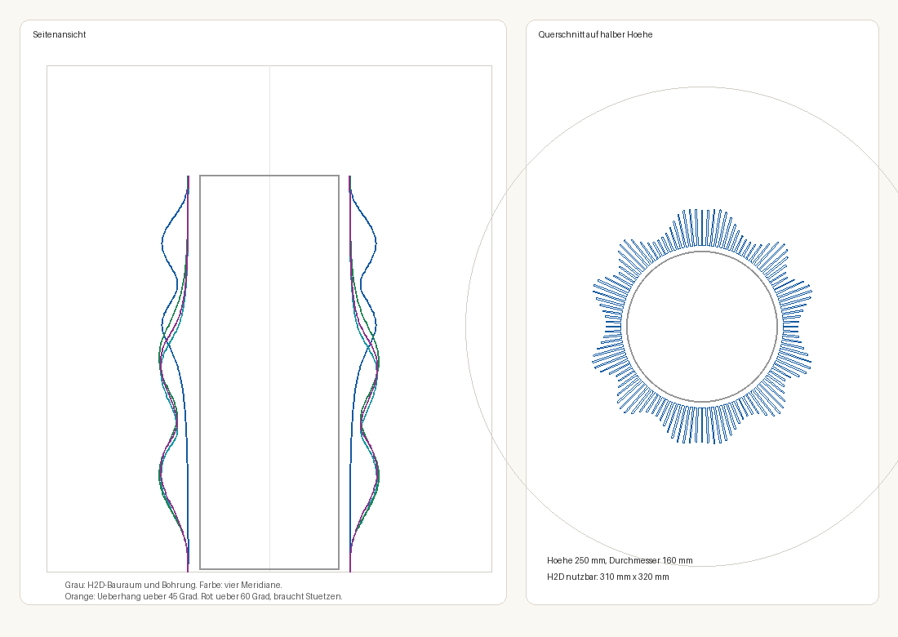

# Vasengenerator

Parametrische Vase für den 3D-Druck. Ein zylindrischer Kern trägt 120 radiale Lamellen. Die Länge jeder Lamelle folgt einer Wellenformel. Innenraum, Höhe und die größte Lamellenlänge sind Schieberegler. Die Druckdatei ist eine STL, direkt aus dem Generator oder aus der 3D-Ansicht.

Die Ausgangsform ist aus `references/referenz.stl` vermessen. Sie ist 250 mm hoch, der Innendurchmesser ist 102 mm, die längste Lamelle misst 25,2 mm. Der Außendurchmesser liegt dann bei 160 mm.



**Inhalt:** [Aufbau](#aufbau) · [Schnellstart](#schnellstart) · [3D-Ansicht](#3d-ansicht) · [Überhang](#überhang) · [Wellenformeln](#wellenformeln) · [Konfiguration](#konfiguration) · [Druck](#druck) · [Mathematik](#mathematik) · [Ordner](#ordner)

## Aufbau

Wasser hält der Kern. Die Lamellen sind die äußere Form und bleiben außen am Kern.

| Teil | Ausgangswert | Bedeutung |
|---|---|---|
| Bohrung | Ø 102 mm | zylindrisch, an der Mündung 2 mm weiter |
| Kernwand | 4 mm | Außenradius des Kerns = Innenradius + 4 mm |
| Boden | 2 mm, geschlossen | die Referenz hatte ein Loch, das Modell nicht |
| Lamellen | 120 Stück, 0,9 mm dick | Teilung 3°, Spitze ein Halbkreis |
| Kürzeste Lamelle | etwa 4 mm | Fuß und Lippe, Anteil 0,158 von `L_max` |
| Längste Lamelle | 25,2 mm | die großen Wellen der Referenz |

Die Länge an der Stelle `(z, θ)` ist

```
s = z / Höhe
länge = L_max · f(s, θ)
Spitze = Innenradius + Kernwand + länge
```

Die vollständige Geometrie steht im Kapitel [Mathematik](#mathematik).

`f` liegt zwischen 0 und 1. Für die Formel `vorlage` ist `f` die gemessene Kante aus `vase/vorlage.json`: alle 0,5 mm eine Stützstelle je Lamelle, dazwischen ein Spline. Kurze Zacken aus dem Dreiecksnetz der Referenz sind herausgefiltert, die großen Wellen bleiben. Der Höchstwert von `f` ist 1, damit `L_max` die längste Lamelle ist.

## Schnellstart

```bash
python3 -m venv .venv
.venv/bin/pip install -r tools/requirements.txt
.venv/bin/python tools/vase_generator.py vase/config.json
```

Danach `vase/vorschau.html` im Browser öffnen. Daneben liegen `vase/vase.stl` für den Slicer und `vase/vorschau.png`.

Python 3 reicht mit den Paketen aus `tools/requirements.txt` (numpy, pillow). Die Vorschau rechnet im Browser und braucht dafür kein Python.

## 3D-Ansicht

Ziehen dreht, das Mausrad zoomt. Der Rahmen ist der nutzbare Bauraum des Druckers.

| Regler | Bereich | Start |
|---|---|---|
| Innendurchmesser | 40–180 mm | 102 mm |
| Höhe | 80–320 mm | 250 mm |
| Lamellenlänge max | 4–70 mm | 25,2 mm |
| Wellenformel | siehe unten | Vorlage, gemessen |
| Überhang auf 45° begrenzen | an/aus | aus |

Der Knopf **Vorlage** setzt alle Regler auf diese Startwerte zurück. Unter den Reglern stehen Lamellenzahl, Dicke, Kernwand, der errechnete Außendurchmesser und ob das Teil auf den Drucker passt.

Die Regler ändern die Ansicht sofort. **STL speichern** lädt das gerade gezeigte Modell herunter, in Millimetern, bereit für den Slicer. Der Dateiname nennt Formel, Höhe und Innendurchmesser.

Dieselbe Ausgangsform schreibt der Generator als `vase/vase.stl`, wenn `vase/config.json` die Startwerte enthält.

## Überhang

Kern und Lamellenseiten stehen senkrecht. Überhängen kann nur die Spitze einer Lamelle, und zwar dort, wo die Lamelle nach oben länger wird. Der Winkel zur Senkrechten zwischen zwei Höhenschnitten ist `atan(Δr / Δz)`. Wird die Lamelle nach oben kürzer, hängt nichts über.

Die Ansicht färbt die Spitzen:

| Farbe | Überhang | Bedeutung |
|---|---|---|
| orange | über 45° | druckt ohne Stützen, die Kante kann bei PETG hängen oder rau werden |
| rot | über 60° | Bambu Studio setzt hier mit der Standardschwelle von 30° zur Waagrechten Stützen |

Unter den Reglern steht der größte Winkel und wie viele Abschnitte rot und orange sind. Der Generator schreibt dieselbe Meldung in die Konsole und färbt die Meridiane in `vorschau.png` genauso. Die Schwellen stehen in `drucker.ueberhang_warnung_grad` und `drucker.stuetze_ab_grad`. Wer in Bambu Studio eine andere Schwelle einstellt, trägt hier `90° − Schwelle` ein. Quelle: [Bambu Studio, Stützeinstellungen](https://all3dp.com/2/bambu-studio-support-settings-simply-explained/).

Der Haken **Überhang auf 45° begrenzen** schaltet die Begrenzung ein, in der Config `ueberhang.begrenzen`. Von Schnitt zu Schnitt darf eine Lamelle dann höchstens um `tan(45°) · Δz` länger werden. Kürzer werden darf sie beliebig schnell. Jede Wölbung bekommt dadurch unten eine 45°-Fase, oben bleibt sie, wie die Formel sie vorgibt. Die Begrenzung rechnet auf den Schnitten des Netzes, also genau auf dem, was gedruckt wird. Herleitung: [Mathematik, Überhang](#4-überhang).

## Wellenformeln

Alle Formeln außer `vorlage`, `gleich` und `ketten` teilen sich dieselbe Hülle: auf den ersten und letzten 16 % der Höhe läuft die Welle ein und aus. Der kurze Rest an Fuß und Lippe bleibt, die Lamellen verschwinden dort nicht. Der Höchstwert jeder Formel ist 1. Herleitung und genaue Formeln stehen im Kapitel [Mathematik](#mathematik).

| Wert | In der Ansicht | Form |
|---|---|---|
| `vorlage` | Vorlage, gemessen | die Kante aus der Referenz |
| `sinus` | Sinus, zwei Loben | zwei weiche Bäuche, 100° Drehung über die ganze Höhe |
| `spirale` | Spirale | laufende Welle, 1,25 Perioden in der Höhe, drei Perioden im Umfang |
| `bluete` | Blüte, fünf Blätter | fünf breite Blätter, ohne Drehung |
| `kaemme` | Breite Kämme | zwei breite Kämme, 90° Drehung in der oberen Hälfte |
| `gleich` | Gleich lang | alle Lamellen gleich, nur ein Bauch über die Höhe |
| `cnoidal` | Cnoidalwelle | breite Wasserwellen-Kämme, schmale Täler |
| `logspirale` | Logarithmische Spirale | zwei Bänder, die sich selbstähnlich nach oben winden |
| `phyllotaxis` | Goldener Winkel | versetzte Höcker wie bei einer Sonnenblume |
| `super` | Superformel | fünf gerundete Blätter aus einer einzigen Formel |
| `ketten` | Kettenlinie | enge Taille, weite Ringe, wie eine Seifenhaut |
| `zeta` | Riemannsche Zetafunktion | schräge Bänder, Kerben an den Nullstellen, eine ruhige und eine bewegte Seite |
| `turing_flecken` | Turing, Flecken | Noppenraster aus einer Reaktion-Diffusion |
| `turing_labyrinth` | Turing, Labyrinth | mäandernde Grate aus derselben Gleichung |

## Konfiguration

`vase/config.json` ist die Quelle für STL und für die Startwerte der Ansicht.

```json
"proportion": {
  "innendurchmesser_mm": 102,
  "hoehe_mm": 250,
  "lamelle_max_mm": 25.221
}
```

Weitere feste Werte:

| Schlüssel | Wert | Wirkung |
|---|---|---|
| `kern.wand_mm` | 4 | Wandstärke des wasserführenden Kerns |
| `lamellen.anzahl` | 120 | Zahl der Lamellen |
| `lamellen.dicke_mm` | 0,9 | Dicke, die Spitze ist ein Halbkreis dieser Dicke |
| `hohlraum.boden_dicke_mm` | 2 | geschlossener Boden |
| `hohlraum.muendung_zugabe_mm` | 2 | die Bohrung öffnet sich an der Lippe um diesen Betrag |
| `welle.funktion` | `vorlage` | eine der Formeln oben |
| `ueberhang.begrenzen` | `false` | Lamellen wachsen nach oben höchstens im Grenzwinkel |
| `ueberhang.winkel_grad` | 45 | Grenzwinkel zur Senkrechten |
| `drucker.ueberhang_warnung_grad` | 45 | ab hier orange |
| `drucker.stuetze_ab_grad` | 60 | ab hier rot, Stützen nötig |
| `aufloesung.schnitte` | 200 | Höhenschnitte des Netzes |
| `aufloesung.punkte_je_schnitt` | 2 | Zwischenpunkte auf dem Kern zwischen zwei Lamellen |

Liegt die Höhe über 320 mm oder der Außendurchmesser über 310 mm, bricht der Generator ab und schreibt keine Dateien. In der Ansicht bleibt das Modell sichtbar, der Statustext meldet, dass es nicht auf den Drucker passt.

## Druck

Drucker ist ein Bambu Lab H2D mit einer Düse 0,4 mm. Eine Düse erreicht 325 × 320 mm in der Fläche. Die linke Düse druckt 320 mm hoch, die rechte 325 mm. Der Generator nimmt den kleineren Wert, damit das Teil auf beiden Düsen liegt: höchstens 310 mm Durchmesser (320 mm Bettiefe abzüglich 5 mm Rand) und 320 mm Höhe. Die Kernwand muss mindestens 1,2 mm bleiben, der Boden mindestens 0,8 mm. Die Lamellen der Ausgangsform sind 0,9 mm dick.

Quellen: [Technische Daten des H2D](https://bambulab.com/en/h2d/tech-specs), [Druckbereich der beiden Düsen](https://wiki.bambulab.com/en/h2/manual/printable-range-for-dual-nozzles).

Die STL in den Slicer laden und aufrecht stellen. Der Boden ist geschlossen, Stützen sind für die Ausgangsform nicht vorgesehen. Meldet der Generator rote Abschnitte, braucht die Form Stützen oder die Überhangbegrenzung.

## Mathematik

Dieses Kapitel leitet jede Formel her und nennt die Zahlen, die im Code stehen. Python (`tools/vase_feature.py`) und die Ansicht (`vase/vorschau.html`) rechnen dieselben Formeln.

### 1. Koordinaten und Grundgleichung

Die Vase steht in Zylinderkoordinaten $(r, \theta, z)$, das Druckbett ist $z = 0$. Die Höhe wird auf $s = z / H \in [0, 1]$ normiert. Die $N = 120$ Lamellen stehen auf den Strahlen

```math
\theta_i = \frac{2\pi i}{N}, \qquad i = 0, \dots, N-1,
```

also alle 3°. Der Kern hat den Außenradius $r_K = D_i/2 + w$ mit dem Innendurchmesser $D_i$ und der Kernwand $w$. Die Spitze der Lamelle $i$ liegt auf der Höhe $z$ bei

```math
r_i(z) = r_K + L_{\max}\, f(s, \theta_i), \qquad 0 \le f \le 1, \quad \max f = 1 .
```

`f` ist die Wellenformel. Weil ihr Höchstwert 1 ist, ist $L_{\max}$ genau die längste Lamelle. Mit den Startwerten ist $r_K = 51 + 4 = 55$ mm und der größte Radius $55 + 25{,}221 = 80{,}2$ mm, Durchmesser 160,4 mm.

**Querschnitt.** Eine Lamelle ist ein Streifen der Dicke $d = 0{,}9$ mm entlang ihres Strahls. Die Spitze ist ein Halbkreis mit Radius $\kappa = \min(d/2,\; r_i - r_K)$ um den Punkt bei $r_i - \kappa$, der Bogen endet also genau auf $r_i$ und steht nicht darüber. Zwischen zwei Lamellen läuft der Kern als Kreisbogen mit `punkte_je_schnitt` Zwischenpunkten.

**Netz.** Der Querschnitt wird auf $K = 200$ Höhen gerechnet,

```math
z_k = \frac{k\,H}{K-1}, \qquad \Delta z = \frac{H}{K-1} = 1{,}256 \text{ mm bei } H = 250 \text{ mm},
```

und Schnitt für Schnitt mit Dreiecken verbunden. Die Bohrung ist ein Zylinder mit Radius $D_i/2$, der sich in den oberen 30 mm mit einem Smoothstep (siehe unten) um 2 mm weitet. Der Boden ist 2 mm dick und geschlossen.

### 2. Gemeinsame Bausteine

**Smoothstep.** Für weiche Übergänge ohne Knick:

```math
S(t) = 3t^2 - 2t^3 \quad \text{für } t \in [0,1], \qquad S = 0 \text{ links}, \; S = 1 \text{ rechts} .
```

$S(0) = 0$, $S(1) = 1$, und die Ableitung ist an beiden Enden null. Wo $S$ etwas ein- oder ausblendet, bleibt die Kante stetig differenzierbar.

**Hülle.** Fuß und Lippe sollen ruhig bleiben:

```math
h(s) = S\!\left(\frac{s}{0{,}16}\right) \cdot S\!\left(\frac{1-s}{0{,}16}\right) .
```

$h$ ist 0 am Boden und an der Lippe und 1 zwischen 16 % und 84 % der Höhe. Bei 250 mm sind das je 40 mm Ein- und Ausblendung.

**Rest.** Die kürzeste Lamelle der Referenz misst etwa 4 mm. Als Anteil von $L_{\max}$ ist das $\rho = 0{,}158$ (3,98 mm). Fast alle Formeln haben deshalb die Form

```math
f(s, \theta) = \rho + (1 - \rho)\, h(s)\, w(s, \theta), \qquad w \in [0, 1] .
```

$w$ ist die eigentliche Welle. Ausnahmen sind `vorlage` (Messung), `gleich` und `ketten` (ohne Hülle).

**Hilfsfunktionen.** $N(x) = \tfrac12\,(\operatorname{clamp}(x, -1, 1) + 1)$ bildet $[-1, 1]$ auf $[0, 1]$ ab. Die Vorzeichenpotenz $\operatorname{sgn}(c)\,|c|^p$ ändert die Form einer Kosinuswelle, ohne ihre Nullstellen zu verschieben: Mit $p < 1$ werden die Kämme breit und flach und die Flanken steil, mit $p > 1$ werden die Kämme schmal. Der Winkelabstand

```math
d(\theta, \varphi) = \bigl|\, ((\theta - \varphi + \pi) \bmod 2\pi) - \pi \,\bigr| \in [0, \pi]
```

misst den kürzeren Weg um den Kreis.

### 3. Die Formeln

#### `vorlage`: die gemessene Kante

Die Kante der Referenz ist als Tafel $F_{j,i}$ in `vase/vorlage.json` gespeichert: 502 Höhen $s_j$ im Abstand 0,002 (0,5 mm) und 120 Spalten, eine je Lamelle. Die Messung ist tiefpassgefiltert. Wellen kürzer als etwa 15 mm waren Dreiecksrauschen des Netzes und sind entfernt. Die Werte liegen zwischen 0,136 und 1.

Im Umfang wird linear zwischen zwei Spalten gemittelt. Auf den Lamellen selbst trifft $\theta_i$ genau eine Spalte. In der Höhe läuft ein **Catmull-Rom-Spline** durch die Stützstellen. Zwischen $s_j$ und $s_{j+1}$, mit $t \in [0, 1]$ und den Werten $p_0, \dots, p_3$ an $j-1, \dots, j+2$:

```math
f(t) = \tfrac12 \Bigl[\, 2p_1 + (p_2 - p_0)\,t + (2p_0 - 5p_1 + 4p_2 - p_3)\,t^2 + (-p_0 + 3p_1 - 3p_2 + p_3)\,t^3 \Bigr] .
```

Der Spline geht exakt durch die Messpunkte, $f(0) = p_1$ und $f(1) = p_2$. Seine Steigung an jeder Stützstelle ist der zentrale Differenzenquotient $(p_2 - p_0)/2$. Damit ist die Kante stetig differenzierbar, ohne Knicke zwischen den Stützstellen. Ein Überschwinger unter null wird abgeschnitten.

#### `sinus`

```math
w = \tfrac12 + \tfrac12 \cos\bigl(2\,(\theta + s \cdot 100^\circ)\bigr)
```

Der Faktor 2 gibt zwei gegenüberliegende Bäuche. Die Phase wächst linear mit der Höhe, die Bäuche drehen sich dadurch auf einer Schraubenlinie um 100° von unten nach oben.

#### `spirale`

```math
w = \tfrac12 + \tfrac12 \sin\bigl(2\pi \cdot 1{,}25\, s + 3\theta\bigr)
```

Linien gleicher Phase erfüllen $3\theta + 2{,}5\pi s = \text{konst.}$ Das sind drei Schraubenlinien, die sich über die ganze Höhe um $2{,}5\pi / 3$ rad = 150° drehen. In der Höhe laufen 1,25 Perioden.

#### `bluete`

```math
c = \cos 5\theta, \qquad w = N\!\left(\operatorname{sgn}(c)\,|c|^{0{,}45}\right)
```

Fünf Maxima bei $\theta = k \cdot 72^\circ$. Der Exponent 0,45 macht die Blätter breit und die Einschnitte zwischen ihnen schmal. Die Formel hängt nicht von $s$ ab, die Blüte steht senkrecht.

#### `kaemme`

```math
\delta(s) = 90^\circ \cdot S\!\left(\frac{s - 0{,}32}{0{,}36}\right), \qquad c = \cos\bigl(2(\theta + \delta)\bigr), \qquad w = N\!\left(\operatorname{sgn}(c)\,|c|^{0{,}55}\right)
```

Zwei breite Kämme stehen bis 32 % der Höhe senkrecht, drehen sich zwischen 32 % und 68 % weich um 90° und stehen darüber wieder senkrecht. Wo ein Kamm in der Drehung über eine Lamelle wandert, wächst sie schnell. Dort hängt die Formel bis 75° über (Abschnitt 4).

#### `gleich`

```math
f = \rho + (1 - \rho)\,\sin(\pi s)^{1{,}15}
```

Unabhängig von $\theta$, also ein Rotationskörper. Ein Bauch auf halber Höhe, der Exponent 1,15 macht ihn etwas schlanker als einen Sinusbogen. Keine Hülle, der Sinus geht an beiden Enden von selbst auf null.

#### `cnoidal`: die Cnoidalwelle

Flache Wasserwellen gehorchen der **Korteweg-de-Vries-Gleichung**, in Normalform

```math
u_t + 6\,u\,u_x + u_{xxx} = 0 .
```

Ihre periodischen Wanderwellen sind keine Sinuswellen. Es sind Cnoidalwellen, das Quadrat der Jacobischen elliptischen Funktion $\operatorname{cn}(u \mid m)$ mit dem Parameter $m = k^2$:

```math
u(x, t) \;\propto\; \operatorname{cn}^2\!\bigl(\,\cdot \mid m\bigr) .
```

`cn` verallgemeinert den Kosinus. Bei $m = 0$ ist $\operatorname{cn}(u \mid 0) = \cos u$. Geht $m$ gegen 1, bleiben die Kämme lang oben und die Täler werden schmal. Im Grenzfall $m = 1$ ist $\operatorname{cn}(u \mid 1) = \operatorname{sech} u$, ein einzelner Soliton. Hier ist $m = 0{,}85$: breite, runde Kämme, schmale Täler, noch periodisch.

Die Periode von $\operatorname{cn}^2$ ist $2K$, mit dem vollständigen elliptischen Integral erster Art

```math
K(m) = \int_0^{\pi/2} \frac{d\varphi}{\sqrt{1 - m \sin^2\varphi}} = \frac{\pi}{2\,\operatorname{agm}\!\left(1, \sqrt{1-m}\right)} = 2{,}389 \quad (m = 0{,}85) .
```

$\operatorname{agm}$ ist das arithmetisch-geometrische Mittel: $a_{n+1} = (a_n + b_n)/2$, $b_{n+1} = \sqrt{a_n b_n}$, bis beide gleich sind. Es konvergiert quadratisch, nach fünf Schritten auf Maschinengenauigkeit. Die Welle auf der Vase ist

```math
u = \frac{2K}{\pi}\,\bigl(\theta + 0{,}45\, s\bigr), \qquad w = \operatorname{cn}^2(u \mid m) .
```

Ein halber Umlauf, $\theta \to \theta + \pi$, verschiebt $u$ um $2K$, eine volle Periode von $\operatorname{cn}^2$. Auf dem Umfang liegen also zwei Kämme. Der Term $0{,}45\,s$ dreht sie über die Höhe um 0,45 rad ≈ 26°. $\operatorname{cn}^2$ liegt von selbst zwischen 0 und 1.

`cn` wird mit der absteigenden Landen-Transformation berechnet (Abramowitz und Stegun, 16.4). Man startet mit $a_0 = 1$, $b_0 = \sqrt{1-m}$, $c_0 = \sqrt{m}$ und iteriert $a_{n+1} = (a_n + b_n)/2$, $b_{n+1} = \sqrt{a_n b_n}$, $c_{n+1} = (a_n - b_n)/2$, bis $c_N \approx 0$. Dann setzt man $\varphi_N = 2^N a_N u$ und läuft zurück mit

```math
\varphi_{n-1} = \tfrac12\left(\varphi_n + \arcsin\!\left(\frac{c_n}{a_n} \sin\varphi_n\right)\right), \qquad \operatorname{cn}(u \mid m) = \cos\varphi_0 .
```

#### `logspirale`: die logarithmische Spirale

Die logarithmische Spirale $r = a\, e^{b\varphi}$, bei Jakob Bernoulli *spira mirabilis*, ist selbstähnlich. Eine Drehung um $\Delta\varphi$ ist dasselbe wie eine Streckung um $e^{b\,\Delta\varphi}$. Auf der Vase übernimmt die Höhe die Rolle des Radius. Der Kamm liegt bei

```math
\varphi(s) = 0{,}9 \cdot \ln(s + 0{,}08), \qquad\text{also}\qquad s + 0{,}08 = e^{\varphi / 0{,}9} .
```

Jede weitere Drehung um $\Delta\varphi$ streckt $s + 0{,}08$ um den Faktor $e^{\Delta\varphi/0{,}9}$. Unten windet sich der Kamm schnell, oben langsam. Über die ganze Höhe dreht er sich um $0{,}9 \ln(1{,}08/0{,}08)$ = 2,34 rad = 134°, davon 57° allein in den unteren 16 %. Zwei Arme liegen sich gegenüber. Die Länge fällt seitlich als Gaußglocke ab:

```math
w = \exp\!\left(-\frac12 \left(\frac{\min\bigl(d(\theta, \varphi),\; d(\theta, \varphi + \pi)\bigr)}{\sigma}\right)^{\!2}\right), \qquad \sigma = 0{,}42 \text{ rad} \approx 24^\circ .
```

#### `phyllotaxis`: der goldene Winkel

Mit dem goldenen Schnitt $\phi = (1 + \sqrt5)/2$ ist der goldene Winkel

```math
\gamma = \frac{2\pi}{\phi^2} = 137{,}508^\circ .
```

Setzt man jeden neuen Punkt um $\gamma$ weiter, wiederholt sich das Muster nie. Der Grund ist, dass $\phi$ die Kettenbruchentwicklung $[1; 1, 1, 1, \dots]$ hat und sich deshalb von allen Zahlen am schlechtesten durch Brüche annähern lässt. Kein Vielfaches von $\gamma$ trifft je genau auf ein Vielfaches von 360°, es entstehen keine radialen Speichen. So stehen die Kerne einer Sonnenblume und die Schuppen eines Tannenzapfens (Vogel 1979: $r_n = c\sqrt n$, $\theta_n = n\gamma$).

Auf der Vase sitzen 42 Höcker:

```math
s_n = \frac{n + \frac12}{42}, \qquad \theta_n = n\,\gamma, \qquad
w = \frac{1}{M} \sum_{n=0}^{41} \exp\!\left(-\frac12\left[\left(\frac{s - s_n}{\sigma_s}\right)^{\!2} + \left(\frac{d(\theta, \theta_n)}{\sigma_\theta}\right)^{\!2}\right]\right)
```

mit $\sigma_s = 0{,}030$ (7,5 mm bei 250 mm) und $\sigma_\theta = 0{,}22$ rad (12,6°). $M$ ist der größte Wert der Summe auf den Höckern im Inneren, sodass $\max w = 1$.

Welche Höcker sich nahe kommen, entscheiden die Fibonacci-Zahlen. Der Abstand von Höcker $n$ zu $n + k$, auf $\pm 180^\circ$ gefaltet:

| $k$ | 1 | 2 | 3 | 5 | 8 | 13 | 21 |
|---|---|---|---|---|---|---|---|
| $\Delta\theta$ | 137,5° | −85,0° | 52,5° | −32,5° | 20,1° | −12,4° | 7,7° |
| $\Delta z$ (mm) | 6,0 | 11,9 | 17,9 | 29,8 | 47,6 | 77,4 | 125,0 |

Je größer die Fibonacci-Zahl, desto kleiner der Winkel. Die Höcker $n, n+5, n+10, \dots$ und $n, n+8, n+16, \dots$ bilden die schrägen Spiralen, die Parastichen, gegenläufig wie an der Blüte.

#### `super`: die Superformel

Johan Gielis hat 2003 die Superellipse von Lamé verallgemeinert:

```math
\rho(\theta) = \left( \left|\cos\frac{m\theta}{4}\right|^{n_2} + \left|\sin\frac{m\theta}{4}\right|^{n_3} \right)^{-1/n_1} .
```

$|\cos|$ und $|\sin|$ haben die Periode $\pi/2$ im Argument, also $2\pi/m$ in $\theta$: $m$ ist die Zahl der Symmetrien. $n_1$ bläht oder schnürt die Form, $n_2$ und $n_3$ runden oder schärfen die Ecken. Hier ist $m = 5$, $n_1 = 0{,}9$, $n_2 = n_3 = 1{,}5$: fünf weiche Blätter. $\rho$ läuft zwischen 0,825 und 1 und wird linear auf $[0, 1]$ gestreckt:

```math
w = \frac{\rho(\theta) - \rho_{\min}}{\rho_{\max} - \rho_{\min}} .
```

#### `ketten`: Kettenlinie und Katenoid

Eine Kette mit konstantem Gewicht je Länge hat überall dieselbe waagrechte Zugkraft $H_0$. Das Kräftegleichgewicht an einem Stück der Kette ergibt

```math
y'' = \frac{1}{a}\sqrt{1 + y'^2}, \qquad a = \frac{H_0}{\mu g}, \qquad y = a \cosh\frac{x}{a} .
```

Das ist die Kettenlinie. Dreht man sie um die senkrechte Achse, entsteht das **Katenoid** (Euler 1744). Es ist neben der Ebene die einzige rotationssymmetrische Minimalfläche: Seine mittlere Krümmung ist überall null. Diese Form nimmt eine Seifenhaut zwischen zwei Ringen an. Die Lamellenlänge folgt diesem Profil, normiert auf 0 in der Taille und 1 an Fuß und Lippe:

```math
f(s) = \rho + (1-\rho)\,\frac{\cosh\bigl((s - \tfrac12)/a\bigr) - 1}{\cosh\bigl(1/(2a)\bigr) - 1}, \qquad a = 0{,}62 .
```

Diese Formel hat keine Hülle, sonst verschwände die Seifenhaut an den Ringen wieder.

#### `zeta`: die Riemannsche Zetafunktion

Für $\operatorname{Re} s > 1$ ist

```math
\zeta(s) = \sum_{n=1}^{\infty} \frac{1}{n^s} = \prod_{p \text{ prim}} \frac{1}{1 - p^{-s}} .
```

Das Produkt nach Euler verbindet $\zeta$ mit den Primzahlen. Die Reihe lässt sich eindeutig auf die ganze Ebene außer $s = 1$ fortsetzen. Dort gilt die **Funktionalgleichung**

```math
\zeta(s) = \chi(s)\, \zeta(1 - s), \qquad |\chi(\sigma + it)| \approx \left(\frac{t}{2\pi}\right)^{1/2 - \sigma} .
```

Die nichttrivialen Nullstellen liegen im kritischen Streifen $0 < \sigma < 1$. Die **Riemannsche Vermutung** sagt, dass sie alle auf der kritischen Linie $\sigma = \tfrac12$ liegen. Die ersten fünf sind $\tfrac12 + i\gamma$ mit $\gamma$ = 14,135, 21,022, 25,011, 30,425, 32,935.

**Abbildung auf die Vase.** Die Höhe läuft auf der imaginären Achse von $t = 12$ bis 36. Jeder Höhenschnitt ist eine Ellipse um den Punkt $\tfrac12 + it$:

```math
\sigma(\theta) = \tfrac12 + 0{,}45 \cos\theta, \qquad
t(s, \theta) = 12 + 24\,s + 2{,}5 \sin\theta, \qquad
w = \min\!\left(1, \frac{|\zeta(\sigma + it)|}{|\zeta|_{\max}}\right),
```

mit $|\zeta|_{\max} = 4{,}574$, abgetastet auf 81 × 72 Punkten. Was man auf der Vase sieht, folgt aus drei Eigenschaften:

1. **Kerben.** Bei $\theta = \pm 90°$ kreuzt die Ellipse die kritische Linie. Trifft sie dort eine Nullstelle, fällt $|\zeta|$ auf null und die Lamelle ist kurz. Die Nullstelle $\gamma$ erscheint bei $\theta = +90°$ auf der Höhe $s = (\gamma - 14{,}5)/24$ und bei $\theta = -90°$ auf $s = (\gamma - 9{,}5)/24$. Jede Nullstelle gibt also zwei Kerben auf gegenüberliegenden Seiten, 52 mm in der Höhe versetzt:

   | $\gamma$ | bei +90° | bei −90° |
   |---|---|---|
   | 14,135 | unter dem Boden | 48 mm |
   | 21,022 | 68 mm | 120 mm |
   | 25,011 | 109 mm | 162 mm |
   | 30,425 | 166 mm | 218 mm (Ausblendung) |
   | 32,935 | 192 mm | 244 mm (Ausblendung) |

   Bei 250 mm Höhe liegen 7 Kerben im Körper, 2 in der Ausblendung.

2. **Schräge Bänder.** Zwischen den Nullstellen wölbt sich $|\zeta|$ zu Rücken. Eine Linie gleichen $t$ liegt auf $s = (t - 12 - 2{,}5\sin\theta)/24$. Sie schwingt um ±0,104 in $s$, also ±26 mm, einmal um die Vase. Ohne den Hub in $t$ wären die Bänder waagrechte Ringe.

3. **Zwei Seiten.** Nach der Funktionalgleichung ist $|\zeta(\tfrac12 - \delta + it)| \approx (t/2\pi)^{\delta}\,|\zeta(\tfrac12 + \delta + it)|$. Bei $\theta = 180°$ ($\sigma = 0{,}05$) sind die Werte um den Faktor $(t/2\pi)^{0{,}45}$ größer als bei $\theta = 0°$ ($\sigma = 0{,}95$): 1,68 bei $t = 20$, 2,02 bei $t = 30$. Nachgerechnet stimmt das auf drei Stellen. Die Seite bei 180° trägt die langen Lamellen, die Seite bei 0° bleibt ruhig.

**Numerik.** $\zeta$ wird mit der **Euler-Maclaurin-Summe** berechnet. Sie setzt die Reihe in den Streifen fort:

```math
\zeta(s) = \sum_{n=1}^{N-1} n^{-s} + \frac{N^{1-s}}{s-1} + \frac{N^{-s}}{2}
+ \sum_{k=1}^{7} \frac{B_{2k}}{(2k)!}\; s(s+1)\cdots(s+2k-2)\; N^{-s-2k+1} + R_7 ,
```

mit $N = 24$ und den Bernoullizahlen $B_2, \dots, B_{14}$ = 1/6, −1/30, 1/42, −1/30, 5/66, −691/2730, 7/6. Gegen `mpmath` geprüft ist der Fehler im Streifen bis $t = 55$ kleiner als $10^{-7}$. Die Ansicht rechnet dieselbe Summe mit eigener komplexer Arithmetik, Python und Ansicht stimmen auf $10^{-14}$ überein.

**Warum $|\zeta|$ linear und nicht $\ln|\zeta|$.** Der Logarithmus macht die Nullstellen zu tiefen Trichtern und sieht dramatischer aus. Die Lamellenkanten hängen dann aber bis 79° über (Abschnitt 4). Mit $|\zeta|$ linear und $t$ von 12 bis 36 bleibt der Überhang unter 43°.

#### `turing_flecken`, `turing_labyrinth`: Reaktion und Diffusion

Alan Turing hat 1952 in *The Chemical Basis of Morphogenesis* gezeigt, dass Diffusion ein Gleichgewicht instabil machen kann, das ohne Diffusion stabil wäre. Zwei Stoffe reagieren miteinander und breiten sich verschieden schnell aus. Ein Band von Wellenlängen wächst dann aus kleinsten Störungen an, alle anderen klingen ab. Was bleibt, ist ein Muster mit einer festen Größe: Flecken, Streifen, Labyrinthe, wie auf dem Fell eines Leoparden oder der Haut eines Kugelfischs.

Das **Gray-Scott-Modell** beschreibt die Reaktion $U + 2V \to 3V$. $V$ katalysiert sich selbst und verbraucht dabei $U$. $U$ wird mit der Rate $F$ nachgefüllt, $V$ mit der Rate $F + k$ entfernt:

```math
\frac{\partial u}{\partial t} = D_u\,\Delta u - u v^2 + F\,(1 - u), \qquad
\frac{\partial v}{\partial t} = D_v\,\Delta v + u v^2 - (F + k)\,v .
```

Mit $D_u = 0{,}16$ und $D_v = 0{,}08$ diffundiert der Nährstoff doppelt so schnell wie der Katalysator. Der Zustand $(u, v) = (1, 0)$ ist stabil. Ein Muster entsteht erst aus örtlichen Keimen und breitet sich von dort aus. Die Form hängt nur von $F$ und $k$ ab (Pearson 1993):

| Formel | $F$ | $k$ | Muster |
|---|---|---|---|
| `turing_flecken` | 0,0367 | 0,0649 | Flecken, die sich teilen, bis sie den Raum gleichmäßig füllen |
| `turing_labyrinth` | 0,029 | 0,057 | Streifen, die sich zu einem Labyrinth verzweigen |

**Diskretisierung.** `tools/turing_tabelle.py` rechnet auf einem Gitter mit $\Delta x = 1$ und dem expliziten Euler-Verfahren mit $\Delta t = 1$. Der Laplace-Operator ist der Fünf-Punkte-Stern:

```math
(\Delta_h u)_{ij} = u_{i+1,j} + u_{i-1,j} + u_{i,j+1} + u_{i,j-1} - 4\,u_{ij},
\qquad
u^{n+1}_{ij} = u^n_{ij} + D_u (\Delta_h u^n)_{ij} - u^n_{ij} (v^n_{ij})^2 + F (1 - u^n_{ij}) .
```

$v$ entsprechend. Das explizite Verfahren ist für die Diffusion stabil, solange $D\,\Delta t / \Delta x^2 \le \tfrac14$, hier $0{,}16$. Im Umfang ist das Gitter periodisch. Oben und unten fließt nichts über den Rand (Neumann-Rand: die Randzeile wird als Geisterzeile wiederholt, der Gradient über den Rand ist null). Start: $u = 1$, $v = 0$, dazu 40 Keime von 5 × 5 Zellen mit $u = 0{,}5$, $v = 0{,}25$ und 2 % Rauschen, Zufallsstart 7. Nach 25 000 Schritten ist das Muster ausgebildet. $v$ wird auf $[0, 1]$ normiert und als Tafel $T$ in `vase/turing.json` gespeichert.

**Maßstab.** Das Gitter liegt auf dem abgewickelten Kern. 150 Zellen im Umfang $2\pi \cdot 55$ mm ergeben 2,30 mm je Zelle. $\operatorname{round}(150 \cdot 250 / 345{,}6) = 109$ Zeilen machen die Zellen bei den Startwerten quadratisch, das Muster ist nicht verzerrt. Die Strukturen wiederholen sich etwa alle 9 Zellen, rund 20 mm. Höhe und Durchmesser in der Ansicht strecken die feste Tafel mit.

**Abtastung.** Wie bei der Vorlage: in der Höhe Catmull-Rom über die Zeilen an der Stelle $s \cdot 108$, im Umfang linear und periodisch an der Stelle $\theta / 2\pi \cdot 150$, dann auf $[0, 1]$ begrenzt. Es ist $f = \rho + (1-\rho)\,h(s)\,T(s, \theta)$.

**Grenze durch den Druck.** Eine Welle mit Amplitude $A$ und Wellenlänge $\lambda$, $\tfrac{A}{2}\,(1 + \sin(2\pi z / \lambda))$, steigt höchstens mit $\pi A / \lambda$. Für höchstens 45° Überhang muss also $\lambda \ge \pi A$ sein. Mit $A = (1 - \rho)\,L_{\max}$ = 21,2 mm heißt das $\lambda \ge 67$ mm. Die Turing-Muster sind mit 20 mm dreimal feiner. Bei voller Lamellenlänge hängen sie bis 74° über. Zwei Auswege: die Überhangbegrenzung einschalten oder $L_{\max}$ auf etwa 10 mm senken.

### 4. Überhang

**Welche Fläche hängt über.** Kern und Bohrung stehen senkrecht. Die Bohrung weitet sich oben höchstens mit 5,7°, und zwar nach außen, sie hängt also nicht über. Die Seiten einer Lamelle sind senkrechte Ebenen mit waagrechter Normale. Überhängen kann nur die Spitze. Für eine glatte Fläche $X(\theta, z) = (r\cos\theta,\; r\sin\theta,\; z)$ ist die Normale

```math
X_\theta \times X_z = \bigl(r_\theta \sin\theta + r\cos\theta,\;\; r\sin\theta - r_\theta\cos\theta,\;\; -r\, r_z\bigr),
```

und der Winkel $\beta$ der Fläche zur Senkrechten erfüllt

```math
\tan\beta = \frac{r\, r_z}{\sqrt{r^2 + r_\theta^2}} \;\le\; r_z .
```

Eine Lamelle ist aber kein Stück dieser Fläche. Ihre halbrunde Kappe hat im Umfang immer dieselbe Form, nur ihr Radius ändert sich mit $z$. Für sie gilt die obere Grenze, $\tan\beta = \partial r / \partial z$. Auf dem Netz zwischen den Schnitten $k$ und $k+1$:

```math
\beta_{k,i} = \arctan\frac{\max\bigl(0,\; r_{k+1,i} - r_{k,i}\bigr)}{\Delta z} .
```

Nur eine wachsende Lamelle hängt über. Wird sie kürzer, liegt jede Schicht auf der vorigen.

**Schwellen.** Bambu Studio setzt Stützen unter Flächen, die flacher als die Schwelle $\alpha_B$ zur Waagrechten liegen, Standard $\alpha_B = 30°$. Zur Senkrechten gemessen heißt das $\beta > 90° - \alpha_B = 60°$. Darüber färbt die Ansicht rot. Ab 45° färbt sie orange: Das druckt ohne Stützen, die 0,9 mm dünne Spitze kann aber hängen.

**Begrenzung.** Mit `ueberhang.begrenzen` wird jede Lamelle von unten nach oben durchgegangen:

```math
\tilde r_{0,i} = r_{0,i}, \qquad
\tilde r_{k,i} = \min\bigl(r_{k,i},\;\; \tilde r_{k-1,i} + \Delta z \tan\alpha\bigr) .
```

Ausgeschrieben ist das

```math
\tilde r_{k,i} = \min_{j \le k} \bigl(r_{j,i} + (z_k - z_j)\tan\alpha\bigr) .
```

Das folgt durch Induktion: Der Schritt $k$ nimmt zum Minimum über $j \le k-1$ den Term $j = k$ hinzu. $\tilde r$ ist das größte Profil, das unter $r$ bleibt und nirgends steiler als $\alpha$ wächst. Geometrisch stülpt man über jeden Punkt der Kante einen nach oben offenen Kegel mit halbem Öffnungswinkel $\alpha$ und nimmt die untere Einhüllende. In der Bildverarbeitung heißt das eine Erosion mit einem einseitigen Kegel.

Daraus folgt:

- Wo $r$ langsam genug wächst, ist $\tilde r = r$.
- Wo $r$ zu schnell wächst, folgt $\tilde r$ einer Geraden im Winkel $\alpha$, bis sie $r$ wieder trifft. Jede Wölbung bekommt unten eine Fase.
- Fallende Flanken bleiben unverändert. Aus Höckern werden Zähne: unten schräg, oben so steil, wie die Formel es vorgibt.
- $\tilde r$ hängt höchstens um $\alpha$ über, auf dem Netz exakt, weil die Begrenzung auf denselben Schnitten rechnet, die gedruckt werden.

**Beispiel.** Bei `phyllotaxis` ist jeder Höcker in der Höhe eine Gaußglocke mit $\sigma = 7{,}5$ mm und Amplitude 21,2 mm. Die steilste Stelle einer Gaußglocke liegt bei $\pm\sigma$ und hat die Steigung $A / (\sigma\sqrt{e})$ = 1,72, also 59,8°. Wo Höcker überlappen, wird es etwas mehr. Gemessen sind es 62°.

### 5. Übereinstimmung von Generator und Ansicht

Jede Formel steht zweimal: in Python für die STL und in JavaScript für die Ansicht. Geprüft mit den Startwerten:

| Prüfung | Ergebnis |
|---|---|
| `zeta`, Python gegen Ansicht | Abweichung $< 10^{-14}$ |
| Netzpunkte, Python gegen Ansicht | höchstens 0,02 mm |
| größter Überhangwinkel | gleich auf 0,02° |
| Zahl der roten Abschnitte | gleich |


## Ordner

```
├── README.md                 diese Anleitung
├── CLAUDE.md                 Arbeitsanweisung für den Agenten
├── docs/
│   ├── PLAN.md               Form, Formeln, Druckgrenzen, Phasen
│   └── analyse-referenz.png  Schnitte durch die Referenz
├── references/
│   └── referenz.stl          vermessenes Netz, wird nicht verändert
├── tools/
│   ├── vase_feature.py       Formel und Körper
│   ├── vase_generator.py     config → STL, HTML, PNG
│   ├── turing_tabelle.py     schreibt vase/turing.json
│   ├── analyse_referenz.py   schreibt das Schnittbild neu
│   └── requirements.txt
└── vase/
    ├── config.json           Parameter und Startwerte
    ├── vorlage.json          gemessene Lamellenkante
    ├── turing.json           Gray-Scott-Muster, aus turing_tabelle.py
    ├── notizen.md            Stand und Verlauf
    ├── vorschau.html         3D-Ansicht, generiert
    ├── vorschau.png          Seitenansicht und Querschnitt, generiert
    └── vase.stl              Drucknetz, generiert
```

Eine weitere Variante bekommt einen eigenen Ordner neben `vase/` mit eigener `config.json`. Die Formel bleibt in `tools/vase_feature.py`. Die gemessene Kante liegt in `vase/vorlage.json` und gilt für die Formel `vorlage`.

## Referenz neu vermessen

`tools/analyse_referenz.py` liest `references/referenz.stl` und schreibt `docs/analyse-referenz.png` neu: vier Meridiane und vier Querschnitte. Die Lamellenkante in `vase/vorlage.json` entsteht nicht aus diesem Skript. Sie ist die bereits gefilterte Messung, aus der der Generator liest.

```bash
.venv/bin/python tools/analyse_referenz.py
```

Der fachliche Stand steht in `docs/PLAN.md`. Die Druckdatei kommt aus diesem Ordner, ein CAD-System ist dafür nicht nötig.
