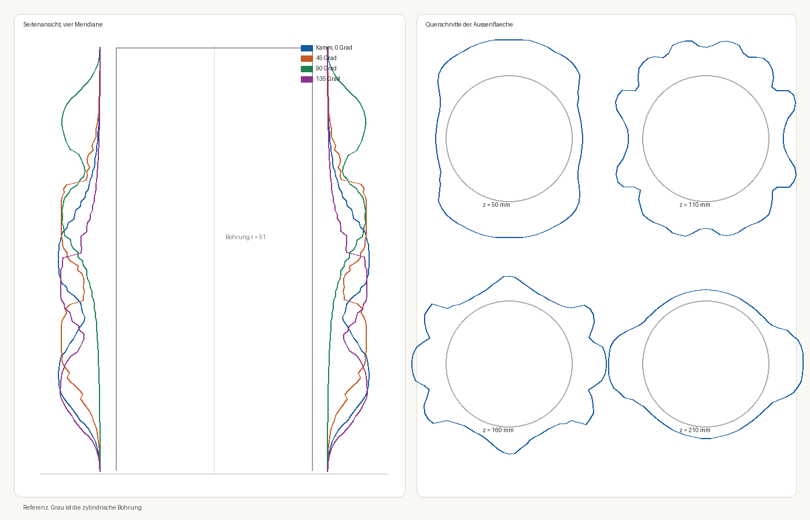

# Plan: Parametrischer Vasengenerator

Stand: 20. Oktober 2026. Die Form ist lokal vermessen. Die Druckdatei ist eine STL.

Eine Vase entsteht als Zylinder mit radialen Lamellen. Die Länge der Lamellen ist eine Wellenformel. Innenraum, Höhe und die größte Länge sind Parameter. Die Rechnung läuft in `tools/vase_feature.py` und, mit denselben Formeln, in `vase/vorschau.html`. Der Generator schreibt `vase/vase.stl`. Die Ansicht lädt die gerade gezeigte Stellung als STL herunter.

Die Referenz ist `references/referenz.stl`.

## 1. Gemessene Referenz

Das Netz hat 1,44 Millionen Dreiecke und steht auf der Z-Achse. Für das Modell zählt die Form.

| Größe | Messung |
|---|---|
| Höhe | 250 mm |
| Bohrung | Ø 102 mm, zylindrisch, an der Mündung etwa Ø 106 mm |
| Kern außen | Ø 110 mm, Wand 4 mm |
| Lamellen | 120 Stück, 0,9 mm dick, Teilung 3° |
| Kürzeste Lamelle | etwa 4 mm, an Fuß und Lippe |
| Längste Lamelle | 25,2 mm |
| Außendurchmesser | 160 mm |
| Boden der Referenz | 2 mm, mit einer Öffnung von Radius 16,7 mm |
| Boden im Modell | 2 mm, geschlossen |

Die Silhouette machen die Lamellen. Der Kern ist ein Rohr und hält das Wasser. Die Referenz öffnet den Boden. Das Modell schließt ihn.



## 2. Formel

```
s = z / Höhe
länge(z, θ) = L_max · f(s, θ)
Spitze = Innenradius + Kernwand + länge
```

`f` liegt zwischen 0 und 1. Der Höchstwert ist 1, damit `L_max` die längste Lamelle ist.

**Vorlage.** `f` steht in `vase/vorlage.json`: 120 Lamellen, Stützstellen alle 0,5 mm. Dazwischen interpoliert ein Catmull-Rom-Spline, die Kante geht glatt durch die Messpunkte. Wellen kürzer als etwa 15 mm sind als Dreiecksrauschen entfernt. Fuß und Lippe bleiben bei etwa 4 mm. An den Stützstellen liegt die Kante auf der Messung.

**Übrige Formeln.** Dieselbe Hülle: auf den ersten und letzten 16 % der Höhe läuft die Welle ein und aus. Ein Restanteil von 0,158 bleibt immer, das sind bei `L_max` = 25,2 mm etwa 4 mm.

| `welle.funktion` | Verlauf |
|---|---|
| `vorlage` | gemessene Kante |
| `sinus` | zwei Loben, Drehung 100° über die ganze Höhe |
| `spirale` | `sin(2π·1,25·s + 3θ)`, laufende Welle |
| `bluete` | fünf Blätter, `\|cos(5θ)\|^0,45`, ohne Drehung |
| `kaemme` | zwei breite Kämme, `\|cos\| ^ 0,55`, 90° Drehung von 32 % bis 68 % der Höhe |
| `gleich` | alle Lamellen gleich, Bauch `sin(πs)^1,15` |
| `cnoidal` | `cn(u, k)²` mit `k² = 0,85`, die periodische Flachwasserwelle |
| `logspirale` | zwei Arme `φ = 0,9·ln(s+0,08)`, seitlich eine Gaußglocke |
| `phyllotaxis` | Höcker auf dem Gitter des goldenen Winkels `2π/φ²` |
| `super` | Superformel von Gielis, fünf Blätter, `m = 5` |
| `ketten` | Katenoid `cosh((s−½)/a)`, eng in der Taille, weit an den Ringen |
| `zeta` | `ln\|ζ(σ+it)\|` auf Ellipsen `σ = ½ + 0,45 cos θ`, `t = 10 + 40s + 3 sin θ` |

Die Spitze jeder Lamelle ist ein Halbkreis mit dem Radius der halben Lamellendicke. Er endet auf dem Radius der Formel und steht nicht darüber hinaus. Das Netz hat 200 Höhenschnitte.

## 3. Parameter

Die drei Proportionen und die Formel sind die Regler der Ansicht und die Startwerte in `vase/config.json`.

| Schlüssel | Start | Wirkung |
|---|---|---|
| `proportion.innendurchmesser_mm` | 102 | Bohrung |
| `proportion.hoehe_mm` | 250 | Gesamthöhe, die Welle skaliert mit |
| `proportion.lamelle_max_mm` | 25,221 | längste Lamelle |
| `welle.funktion` | `vorlage` | eine der sechs Formeln |
| `kern.wand_mm` | 4 | Wand des Kerns |
| `lamellen.anzahl` | 120 | |
| `lamellen.dicke_mm` | 0,9 | |
| `hohlraum.boden_dicke_mm` | 2 | geschlossen |
| `hohlraum.muendung_zugabe_mm` | 2 | Bohrung an der Lippe |
| `aufloesung.schnitte` | 200 | Höhenschnitte |
| `aufloesung.punkte_je_schnitt` | 2 | Bogen des Kerns zwischen den Lamellen |

Schieberegler in `vase/vorschau.html` ändern die Ansicht, ohne `config.json` zu schreiben. Die STL entsteht aus der Config.

## 4. Druckgrenzen

Bambu Lab H2D, eine Düse, Düse 0,4 mm. Fläche einer Düse 325 × 320 mm. Höhe der linken Düse 320 mm, der rechten 325 mm. Der Generator begrenzt auf den kleineren Wert, abzüglich 5 mm Rand in der Fläche:

- Durchmesser höchstens 310 mm
- Höhe höchstens 320 mm
- Kernwand mindestens 1,2 mm
- Boden mindestens 0,8 mm

Was darüber liegt, schreibt der Generator nicht. Die Ansicht zeigt es und meldet den Überstand.

[Technische Daten](https://bambulab.com/en/h2d/tech-specs), [Druckbereich der Düsen](https://wiki.bambulab.com/en/h2/manual/printable-range-for-dual-nozzles).

## 5. Druckdatei

`python tools/vase_generator.py vase/config.json` schreibt `vase/vase.stl` aus der Config. In `vase/vorschau.html` schreibt **STL speichern** die aktuelle Reglerstellung. Beide Netze sind geschlossen, Einheiten sind Millimeter.

## 6. Phasen

**Phase 1, Form klären.** Erledigt. Die Referenz ist ein Kern mit 120 Lamellen.

**Phase 2, lokale Vorschau und STL.** Erledigt als prüfbare Ansicht und Druckdatei. STL, HTML und PNG erzeugt `tools/vase_generator.py`.

**Phase 3, Druck.** STL in Bambu Studio, Probedruck, Rückmeldung nach `config.json` und `vase/notizen.md`.

## 7. Festgelegt

- Boden geschlossen.
- Drucker H2D, eine Düse, Grenzen wie in Abschnitt 4.
- Ausgangsform ist die gemessene Kante, nicht eine nachträglich erfundene Hülle.
- Namen der Referenzdatei stehen nicht im Projekt. Die Datei heißt `references/referenz.stl`.
